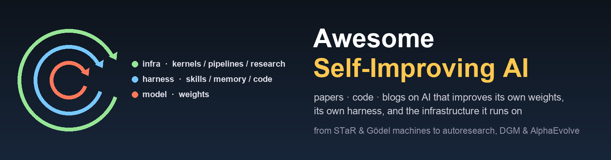

<div align="center">
  
</div>


<div align="center">


<br>


<br>


<br>


</div>

# When AI Improves Itself

**Awesome Self-Improving AI** is an awesome list summarising **papers, open-source code, and technical blogs** on AI systems that improve **themselves** — organised along the three things a modern AI system is made of:

 - 🧠 **Model** — the weights. Self-generated data, self-rewarding, self-play, zero-data RL, self-adapting updates.
 - 🧰 **Harness** — everything wrapped around the weights: prompts and context, **memory**, **skills**, tools, workflows, the agent's own source code, and the evaluators that judge it.
 - 🏗️ **Infra** — the stack the model runs on and is trained with: GPU kernels, compilers and serving configs, training pipelines, data engines, and the research process that produces the next model.

 - 🎯 **Self-improvement = S1 + S2 + S3.** `S1`: the improvement *signal* is produced by the system itself or by an automated evaluator, not by fresh human labels. `S2`: the update is *committed* to a persistent component (weights, a harness artifact, an infra artifact) that is reused on future tasks. `S3`: the loop can *iterate* — the improved system is the one that produces the next improvement. Methods that satisfy only part of this are flagged in **📝 Strictness notes** per section.
 - 🚀 Each entry is annotated along three design axes — **what is modified** (weights · prompt/context · memory · skills · tools · workflow · harness code · evaluator · kernel/compiler · serving/training config · data · research process), **improvement signal** (self-consistency · self-judge/rubric · verifier/tests · environment reward · benchmark score · profiler/runtime · human-in-the-loop), and **loop closure** (`L1` one-shot refinement · `L2` bounded iteration with a fixed evaluator · `L3` open-ended / recursive, where the improver itself is improved).
 - ⚠️ Built by reading arXiv abstracts, project pages, and repos with LLM coding agents; cross-checked against the community lists in 🔗 Other Awesome Lists; manually reviewed but errors possible. PRs welcome.
 - 📌 If you find this repository helpful for your research, please cite it via the **"Cite this repository"** button in the right sidebar of the GitHub page.
 - 📅 Last updated: 2026-09-04

Taxonomy:
 - **📚 Surveys, Foundations & Position Papers** — Good, Gödel machines, the 2025–2026 surveys, the RSI definition debate
 - **🧠 Model** — 🧪 self-generated data & self-rewarding · ♟️ self-play & zero-data · 🔗 weights + harness co-evolution
 - **🧰 Harness** — ✍️ prompt & context · 💾 memory · 🧩 skills · 🕸️ workflow / agent-architecture search · 🔧 self-modifying harness code · ⚖️ evolving evaluators
 - **🏗️ Infra** — ⚙️ kernels · 🧮 compilers, serving & config · 🏭 training & data pipelines · 🧬 program & algorithm discovery
 - **🔬 Automated AI Research** — where all three loops close: systems that run the research process that makes the next system
 - **📊 Benchmarks** · **⚠️ Safety & Limits** · **🛠️ Frameworks & Code** · **📰 Blogs & Talks**

Shorthand: **RSI** = recursive self-improvement · **DGM/HGM** = Darwin / Huxley Gödel Machine · **RLVR** = RL with verifiable rewards · **MLE** = machine-learning engineering · `📄 paper-only` = no public code yet.

## Updates

<details>
<summary>📢 click to expand</summary>

- **2026-09-04** — initial release: ~230 papers, 50+ code repos, 30 blogs/talks. Seeded from arXiv, the GitHub awesome lists on self-evolving agents / RSI / agent memory / kernel generation (credited below), Lilian Weng's harness-engineering reading list, and the Sep 2026 coverage of Anthropic's "When AI builds itself", Weco's AIDE², and Karpathy's autoresearch.

</details>

---

## 📚 Surveys, Foundations & Position Papers

| Resource | 🌟 Stars | Date | Org | Paper / Link | Title / Notes |
| :----: | :----: | :----: |  :----: | :----: | :---- |
| [Good 1965](https://languagelog.ldc.upenn.edu/myl/Good1964.pdf) | [](https://languagelog.ldc.upenn.edu/myl/Good1964.pdf) | 1965 | I. J. Good | [PDF](https://languagelog.ldc.upenn.edu/myl/Good1964.pdf) | **Speculations Concerning the First Ultraintelligent Machine** — coins the intelligence explosion: a machine that designs better machines |
| [Gödel Machine](https://arxiv.org/abs/cs/0309048) | [](https://arxiv.org/abs/cs/0309048) | 2003 | IDSIA (Schmidhuber) | [arXiv cs/0309048](https://arxiv.org/abs/cs/0309048) · [metalearning page](https://people.idsia.ch/~juergen/metalearning.html) | **Gödel Machines: Self-Referential Universal Problem Solvers Making Provably Optimal Self-Improvements** (Seminal) — rewrites any part of its own code once it can *prove* the rewrite helps; the theoretical north star every "Gödel" agent cites |
| [POWERPLAY](https://arxiv.org/abs/1112.5309) | [](https://arxiv.org/abs/1112.5309) | 2011 | IDSIA (Schmidhuber) | [arXiv 1112.5309](https://arxiv.org/abs/1112.5309) | **Training an Increasingly General Problem Solver by Continually Searching for the Simplest Still Unsolvable Problem** — the open-ended self-invented-curriculum idea behind AZR / R-Zero |
| [RSI Software](https://arxiv.org/abs/1502.06512) | [](https://arxiv.org/abs/1502.06512) | 2015 | Yampolskiy | [arXiv 1502.06512](https://arxiv.org/abs/1502.06512) | **From Seed AI to Technological Singularity via Recursively Self-Improving Software** — formal definitions of RSI and convergence limits |
| [AutoML-Zero](https://arxiv.org/abs/2003.03384) | [](https://arxiv.org/abs/2003.03384) | 2020.03 | Google Brain (Real, Liang, So, Le) | [arXiv 2003.03384](https://arxiv.org/abs/2003.03384) · [code](https://github.com/google-research/google-research/tree/master/automl_zero) | **AutoML-Zero: Evolving Machine Learning Algorithms From Scratch** (ICML 2020) — evolutionary search rediscovers backprop from basic ops; the pre-LLM ancestor of AlphaEvolve-style algorithm discovery |
| [LLM Self-Evolution Survey](https://arxiv.org/abs/2404.14387) | [](https://arxiv.org/abs/2404.14387) | 2024.04 | Alibaba / PKU (Tao et al.) | [arXiv 2404.14387](https://arxiv.org/abs/2404.14387) | **A Survey on Self-Evolution of Large Language Models** — the first survey to frame experience acquisition → refinement → updating → evaluation as one loop |
| [Self-Evolving Agents Survey](https://github.com/XMUDeepLIT/Awesome-Self-Evolving-Agents) |  | 2025.07 | Princeton / Tsinghua et al. (Gao et al.) | [arXiv 2507.21046](https://arxiv.org/abs/2507.21046) | **A Survey of Self-Evolving Agents: What, When, How, and Where to Evolve on the Path to ASI** — what (model / memory / tools / architecture), when (intra- vs inter-test-time), how (reward / imitation / population) |
| [Comprehensive Survey (EvoAgentX)](https://github.com/ANative-Lab/Awesome-Self-Evolving-Agents) |  | 2025.08 | Glasgow / EvoAgentX (Fang et al.) | [arXiv 2508.07407](https://arxiv.org/abs/2508.07407) | **A Comprehensive Survey of Self-Evolving AI Agents: A New Paradigm Bridging Foundation Models and Lifelong Agentic Systems** — single-agent / multi-agent / domain-specific optimisation taxonomy |
| [Adaptation of Agentic AI](https://arxiv.org/abs/2512.16301) | [](https://arxiv.org/abs/2512.16301) | 2025.12 | UIUC (Jiang, Lin, …) | [arXiv 2512.16301](https://arxiv.org/abs/2512.16301) | **Adaptation of Agentic AI: A Survey of Post-Training, Memory, and Skills** — the survey that uses exactly this repo's split: weights vs memory vs skills |
| [Externalization Review](https://arxiv.org/abs/2604.08224) | [](https://arxiv.org/abs/2604.08224) | 2026.04 | — | [arXiv 2604.08224](https://arxiv.org/abs/2604.08224) | **Externalization in LLM Agents: A Unified Review of Memory, Skills, Protocols and Harness Engineering** — argues capability is moving *out* of the weights into the harness |
| [Agent System & Harness Design](https://arxiv.org/abs/2606.20683) | [](https://arxiv.org/abs/2606.20683) | 2026.06 | Guo, Hao et al. | [arXiv 2606.20683](https://arxiv.org/abs/2606.20683) | **From Question Answering to Task Completion: A Survey on Agent System and Harness Design** |
| [Workflow Optimisation Survey](https://arxiv.org/abs/2603.22386) | [](https://arxiv.org/abs/2603.22386) | 2026.03 | Yue, Bhandari et al. | [arXiv 2603.22386](https://arxiv.org/abs/2603.22386) | **From Static Templates to Dynamic Runtime Graphs: A Survey of Workflow Optimization for LLM Agents** |
| [Kernel Generation Survey](https://github.com/flagos-ai/awesome-LLM-driven-kernel-generation) |  | 2026.01 | FlagOS (Yu, Zang, …) | [arXiv 2601.15727](https://arxiv.org/abs/2601.15727) | **Towards Automated Kernel Generation in the Era of LLMs** — LLM4Kernel (SFT/RL) vs Agent4Kernel (learning · memory · profiling · multi-agent) |
| [Measuring AI R&D Automation](https://arxiv.org/abs/2603.03992) | [](https://arxiv.org/abs/2603.03992) | 2026.03 | Chan, Padarath et al. | [arXiv 2603.03992](https://arxiv.org/abs/2603.03992) | **Measuring AI R&D Automation** — what would count as evidence that AI is doing AI research |
| [Bounded vs Open-Ended RSI](https://arxiv.org/abs/2607.07663) | [](https://arxiv.org/abs/2607.07663) | 2026.07 | Chen, Wang | [arXiv 2607.07663](https://arxiv.org/abs/2607.07663) | **Recursive Self-Improvement in AI: From Bounded Self-Refinement to Autonomous Research Loops** — makes *loop closure* the defining axis; four improvement targets (deployment behaviour, training policy, evaluator, research process) |
| [Self-Improvements in Agentic Systems](https://github.com/selfimproving-agent/Awesome-Self-Improving-Agents) |  | 2026.07 | Ren, Chen et al. | [arXiv 2607.13104](https://arxiv.org/abs/2607.13104) | **Self-Improvements in Modern Agentic Systems: A Survey** — defines self-improvement as a *self-induced update operator* over parameters or scaffold; foundation-model vs scaffolding improvement |
| [Co-Evolution Survey](https://arxiv.org/abs/2608.10299) | [](https://arxiv.org/abs/2608.10299) | 2026.08 | Zong, Liu et al. | [arXiv 2608.10299](https://arxiv.org/abs/2608.10299) | **Co-Evolution in Agentic Systems: Toward Self-Directed Evolution Beyond Human Design** — first survey organised around agent ↔ evaluator ↔ environment co-evolution |

<details>
<summary>📝 <b>Strictness notes</b> (against <code>S1 self-produced signal</code> + <code>S2 persistent update</code> + <code>S3 iterable loop</code>)</summary>

- **Good / Gödel Machine / Yampolskiy** are theory: no implementation, kept as the reference definitions. The [RSI definition comparison](https://github.com/Persdre/awesome-recursive-self-improvement#what-counts-as-rsi) in Persdre's list shows that of the canonical sources only two even use the word "recursive".
- **AutoML-Zero** improves *ML algorithms*, not itself; listed because AlphaEvolve-style discovery descends from it.
- Surveys disagree on the top-level split: model-vs-scaffold (2607.13104), what/when/how (2507.21046), post-training/memory/skills (2512.16301). This list uses model / harness / infra because that is how the artifacts are actually deployed.

</details>

---

## 🧠 Model — 🧪 Self-Generated Data & Self-Rewarding

The weights are updated on data, labels, or rewards the model produced itself.

| Resource | 🌟 Stars | Date | Org | Paper / Link | Title / Notes |
| :----: | :----: | :----: |  :----: | :----: | :---- |
| [STaR](https://github.com/ezelikman/STaR) |  | 2022.03 | Stanford / Google (Zelikman, Wu, Mu, Goodman) | [arXiv 2203.14465](https://arxiv.org/abs/2203.14465) | **STaR: Bootstrapping Reasoning With Reasoning** (Seminal · NeurIPS 2022) — generate rationales, keep the ones that reach the right answer, fine-tune, repeat; the modern weight-level bootstrap |
| [LMSI](https://arxiv.org/abs/2210.11610) | [](https://arxiv.org/abs/2210.11610) | 2022.10 | Google (Huang et al.) | [arXiv 2210.11610](https://arxiv.org/abs/2210.11610) | **Large Language Models Can Self-Improve** (EMNLP 2023) — self-consistency-majority answers as pseudo-labels for unlabeled questions |
| [Constitutional AI](https://arxiv.org/abs/2212.08073) | [](https://arxiv.org/abs/2212.08073) | 2022.12 | Anthropic (Bai et al.) | [arXiv 2212.08073](https://arxiv.org/abs/2212.08073) | **Constitutional AI: Harmlessness from AI Feedback** — self-critique + revision, then RL from AI feedback; the template for replacing human labels with model judgements |
| [Self-Instruct](https://github.com/yizhongw/self-instruct) |  | 2022.12 | UW (Wang et al.) | [arXiv 2212.10560](https://arxiv.org/abs/2212.10560) | **Self-Instruct: Aligning Language Models with Self-Generated Instructions** (ACL 2023) — bootstrap an instruction dataset from the model itself |
| [ReST](https://arxiv.org/abs/2308.08998) | [](https://arxiv.org/abs/2308.08998) | 2023.08 | Google DeepMind (Gulcehre et al.) | [arXiv 2308.08998](https://arxiv.org/abs/2308.08998) | **Reinforced Self-Training (ReST) for Language Modeling** — Grow (sample) / Improve (filter + train) loop |
| [RLAIF vs RLHF](https://arxiv.org/abs/2309.00267) | [](https://arxiv.org/abs/2309.00267) | 2023.09 | Google (Lee et al.) | [arXiv 2309.00267](https://arxiv.org/abs/2309.00267) | **RLAIF vs. RLHF: Scaling RL from Human Feedback with AI Feedback** (ICML 2024) — AI-labelled preferences match human ones at scale |
| [ReST-EM](https://arxiv.org/abs/2312.06585) | [](https://arxiv.org/abs/2312.06585) | 2023.12 | Google DeepMind (Singh et al.) | [arXiv 2312.06585](https://arxiv.org/abs/2312.06585) | **Beyond Human Data: Scaling Self-Training for Problem-Solving with Language Models** (TMLR) — expectation-maximisation view of STaR-style self-training; scales past human data on math/code |
| [SPIN](https://github.com/uclaml/SPIN) |  | 2024.01 | UCLA (Chen et al.) | [arXiv 2401.01335](https://arxiv.org/abs/2401.01335) | **Self-Play Fine-Tuning Converts Weak Language Models to Strong Language Models** (ICML 2024) — the model discriminates its own generations from human data, DPO-style |
| [Self-Rewarding LMs](https://arxiv.org/abs/2401.10020) | [](https://arxiv.org/abs/2401.10020) | 2024.01 | Meta FAIR / NYU (Yuan et al.) | [arXiv 2401.10020](https://arxiv.org/abs/2401.10020) | **Self-Rewarding Language Models** (ICML 2024) — the model is its own reward model via LLM-as-a-judge; iterative DPO improves both policy *and* judge |
| [V-STaR](https://arxiv.org/abs/2402.06457) | [](https://arxiv.org/abs/2402.06457) | 2024.02 | Mila / Google (Hosseini et al.) | [arXiv 2402.06457](https://arxiv.org/abs/2402.06457) | **V-STaR: Training Verifiers for Self-Taught Reasoners** (COLM 2024) — use the *incorrect* self-generated solutions to train a verifier |
| [Quiet-STaR](https://github.com/ezelikman/quiet-star) |  | 2024.03 | Stanford (Zelikman et al.) | [arXiv 2403.09629](https://arxiv.org/abs/2403.09629) | **Quiet-STaR: Language Models Can Teach Themselves to Think Before Speaking** (COLM 2024) — learn per-token internal rationales from LM likelihood alone |
| [Meta-Rewarding](https://arxiv.org/abs/2407.19594) | [](https://arxiv.org/abs/2407.19594) | 2024.07 | Meta FAIR (Wu, Yuan, …) | [arXiv 2407.19594](https://arxiv.org/abs/2407.19594) | **Meta-Rewarding Language Models: Self-Improving Alignment with LLM-as-a-Meta-Judge** — the model also judges its own judgements, so the reward signal improves too |
| [Self-Evolved Reward Learning](https://arxiv.org/abs/2411.00418) | [](https://arxiv.org/abs/2411.00418) | 2024.11 | Huang, Fan et al. | [arXiv 2411.00418](https://arxiv.org/abs/2411.00418) | **Self-Evolved Reward Learning for LLMs** — the reward model labels its own training data iteratively |
| [rStar-Math](https://github.com/microsoft/rStar) |  | 2025.01 | Microsoft (Guan, Zhang, …) | [arXiv 2501.04519](https://arxiv.org/abs/2501.04519) | **rStar-Math: Small LLMs Can Master Math Reasoning with Self-Evolved Deep Thinking** (ICML 2025) — four rounds of MCTS-generated, code-verified data co-evolve policy and process reward model; 7B reaches o1-level MATH |
| [Self-Improving VLM Judges](https://arxiv.org/abs/2512.05145) | [](https://arxiv.org/abs/2512.05145) | 2025.12 | Lin, Hu et al. | [arXiv 2512.05145](https://arxiv.org/abs/2512.05145) | **Self-Improving VLM Judges Without Human Annotations** — the judge bootstraps its own preference data |
| [EvoLM](https://github.com/stellalisy/EvoLM) |  | 2026.05 | UW (Li, Xin, … Tsvetkov) | [arXiv 2605.03871](https://arxiv.org/abs/2605.03871) | **EvoLM: Self-Evolving Language Models through Co-Evolved Discriminative Rubrics** — the rubric that scores generations evolves alongside the policy |
| [Autodata](https://arxiv.org/abs/2606.25996) | [](https://arxiv.org/abs/2606.25996) | 2026.06 | Meta FAIR (Kulikov, Whitehouse, …) | [arXiv 2606.25996](https://arxiv.org/abs/2606.25996) | **Autodata: An Agentic Data Scientist to Create High Quality Synthetic Data** — an agent that designs, generates and validates the synthetic training data for the next model |

<details>
<summary>📋 Click to view technical details</summary>

| Resource | What is modified | Improvement signal | Loop closure | Notes |
| :----: | :----: | :----: | :----: | :---- |
| STaR | weights (SFT) | answer correctness (verifier) | L2 | rationalisation on failures |
| LMSI | weights (SFT) | self-consistency majority | L2 | no verifier needed |
| Constitutional AI | weights (SFT + RL) | self-critique vs a written constitution | L1→L2 | human writes the constitution once |
| ReST / ReST-EM | weights | reward model / binary correctness | L2 | grow–improve iterations |
| SPIN | weights (DPO) | discriminating own vs human data | L2 | needs a human SFT set as the "real" class |
| Self-Rewarding / Meta-Rewarding | weights (DPO) | LLM-as-judge on own outputs | L3 (judge improves too) | reward hacking risk rises with iterations |
| rStar-Math | policy + PRM | code-execution verification + MCTS | L2 | 4 rounds |
| EvoLM | weights + rubric | co-evolved rubric | L3 | evaluator is a moving target |

</details>

<details>
<summary>📝 <b>Strictness notes</b></summary>

- **Constitutional AI** and **RLAIF** need a human-written constitution or prompt once; after that the signal is model-produced (S1 holds, S3 only weakly).
- **SPIN** needs a fixed human SFT set as the positive class, so it converges rather than improving open-endedly.
- The cautionary results for this whole section live in ⚠️ Safety & Limits: *Sharpening* (2412.01951), *Mind the Gap* (2412.02674), *Cannot Self-Correct Yet* (2310.01798) and the model-collapse papers.

</details>

---

## 🧠 Model — ♟️ Self-Play, Zero-Data RL & Self-Adapting Weights

The model invents its own tasks, plays against itself, or writes its own weight updates.

| Resource | 🌟 Stars | Date | Org | Paper / Link | Title / Notes |
| :----: | :----: | :----: |  :----: | :----: | :---- |
| [SPAG](https://github.com/Linear95/SPAG) |  | 2024.04 | Tencent AI Lab (Cheng et al.) | [arXiv 2404.10642](https://arxiv.org/abs/2404.10642) | **Self-playing Adversarial Language Game Enhances LLM Reasoning** (NeurIPS 2024) — attacker/defender word game as a self-play RL signal |
| [TTRL](https://github.com/PRIME-RL/TTRL) |  | 2025.04 | Tsinghua / Shanghai AI Lab (Zuo et al.) | [arXiv 2504.16084](https://arxiv.org/abs/2504.16084) | **TTRL: Test-Time Reinforcement Learning** (NeurIPS 2025) — majority vote over samples as the reward on *unlabeled test data*; RL at test time |
| [Absolute Zero](https://github.com/LeapLabTHU/Absolute-Zero-Reasoner) |  | 2025.05 | Tsinghua LeapLab (Zhao et al.) | [arXiv 2505.03335](https://arxiv.org/abs/2505.03335) | **Absolute Zero: Reinforced Self-play Reasoning with Zero Data** (NeurIPS 2025) — one model proposes code-reasoning tasks and solves them; a Python executor is the only ground truth |
| [SEAL](https://github.com/Continual-Intelligence/SEAL) |  | 2025.06 | MIT (Zweiger, Pari, … Agrawal) | [arXiv 2506.10943](https://arxiv.org/abs/2506.10943) | **Self-Adapting Language Models** (NeurIPS 2025) — the model writes its own fine-tuning data and update directives ("self-edits"); an RL outer loop rewards edits that improve downstream performance |
| [SPIRAL](https://github.com/spiral-rl/spiral) |  | 2025.06 | NUS / Sea AI Lab (Liu, Guertler, …) | [arXiv 2506.24119](https://arxiv.org/abs/2506.24119) | **SPIRAL: Self-Play on Zero-Sum Games Incentivizes Reasoning via Multi-Agent Multi-Turn RL** (ICLR 2026) — self-play on Kuhn poker / TicTacToe transfers to math reasoning |
| [R-Zero](https://github.com/Chengsong-Huang/R-Zero) |  | 2025.08 | Tencent AI Seattle / WashU (Huang et al.) | [arXiv 2508.05004](https://arxiv.org/abs/2508.05004) | **R-Zero: Self-Evolving Reasoning LLM from Zero Data** (ICLR 2026) — Challenger and Solver initialised from one model co-evolve; the Challenger targets the Solver's uncertainty frontier |
| [Language Self-Play](https://arxiv.org/abs/2509.07414) | [](https://arxiv.org/abs/2509.07414) | 2025.09 | Meta (Kuba, Gu, …) | [arXiv 2509.07414](https://arxiv.org/abs/2509.07414) | **Language Self-Play For Data-Free Training** — a single model alternates between query-generator and responder modes |
| [Reward-Free Self-Evolution](https://arxiv.org/abs/2604.18131) | [](https://arxiv.org/abs/2604.18131) | 2026.04 | Zhang, Ma et al. | [arXiv 2604.18131](https://arxiv.org/abs/2604.18131) | **Training LLM Agents for Spontaneous, Reward-Free Self-Evolution via World Knowledge Exploration** |
| [Skill Self-Play](https://github.com/Qwen-Applications/skill-self-play) |  | 2026.07 | Alibaba Qwen | [arXiv 2607.22529](https://arxiv.org/abs/2607.22529) | **Skill Self-Play: Pushing the Frontier of LLM Capability with Co-Evolving Skills** — the self-play curriculum is expressed as evolving *skills* rather than raw problems; bridges this section and 🧩 Skills |

<details>
<summary>📋 Click to view technical details</summary>

| Resource | Task source | Reward source | What is modified | Loop closure |
| :----: | :----: | :----: | :----: | :----: |
| TTRL | unlabeled test set | majority vote | weights | L2 |
| Absolute Zero | self-proposed code tasks | Python executor | weights (proposer + solver) | L3 |
| R-Zero | Challenger model | Solver self-consistency + Challenger uncertainty reward | weights ×2 | L3 |
| SPIRAL | zero-sum games | game outcome | weights | L3 |
| SEAL | given task data | downstream eval after self-edit | weights via self-written SFT | L2 (RL outer loop, fixed eval) |
| Language Self-Play | self-generated queries | self-judge | weights | L3 |

</details>

<details>
<summary>📝 <b>Strictness notes</b></summary>

- **TTRL** improves on a fixed test distribution; it is adaptation, not open-ended growth.
- **Absolute Zero / R-Zero / SPIRAL** are the cleanest S1+S2+S3 examples at the weight level, but all rely on an *external executor or game engine* for ground truth — the loop is closed over tasks, not over the verifier.
- **SEAL** is the canonical "model writes its own weight update" paper; its outer RL loop still uses a human-designed evaluation.

</details>

---

## 🧠 Model — 🔗 Weights + Harness Co-Evolution

Runtime experience becomes both harness artifacts (memory, skills, harness code) *and* gradient updates.

| Resource | 🌟 Stars | Date | Org | Paper / Link | Title / Notes |
| :----: | :----: | :----: |  :----: | :----: | :---- |
| [Mem-α](https://github.com/wangyu-ustc/Mem-alpha) |  | 2025.09 | UCSD / … (Wang, Takanobu, …) | [arXiv 2509.25911](https://arxiv.org/abs/2509.25911) | **Mem-α: Learning Memory Construction via Reinforcement Learning** — RL trains the model to decide what to write to memory |
| [MemRL](https://github.com/MemTensor/MemRL) |  | 2026.01 | MemTensor (Zhang, Wang, …) | [arXiv 2601.03192](https://arxiv.org/abs/2601.03192) | **MemRL: Self-Evolving Agents via Runtime Reinforcement Learning on Episodic Memory** — frozen LLM, RL over *which memories to retrieve*; the memory is the learnable component |
| [ECHO](https://arxiv.org/abs/2601.06794) | [](https://arxiv.org/abs/2601.06794) | 2026.01 | Li, Jiang et al. | [arXiv 2601.06794](https://arxiv.org/abs/2601.06794) | **No More Stale Feedback: Co-Evolving Critics for Open-World Agent Learning** — critic and policy updated together so the critic does not lag the policy's distribution shift |
| [SkillRL](https://github.com/aiming-lab/SkillRL) |  | 2026.02 | UNC (Xia, Chen, …) | [arXiv 2602.08234](https://arxiv.org/abs/2602.08234) | **SkillRL: Evolving Agents via Recursive Skill-Augmented RL** — trajectories distilled into a hierarchical SkillBank that is refined recursively from verification failures during RL |
| [OpenClaw-RL](https://github.com/Gen-Verse/OpenClaw-RL) |  | 2026.03 | Gen-Verse (Wang, Chen, …) | [arXiv 2603.10165](https://arxiv.org/abs/2603.10165) | **OpenClaw-RL: Train Any Agent Simply by Talking** — conversational feedback turned into RL signal for a deployed agent |
| [RewardHarness](https://arxiv.org/abs/2605.08703) | [](https://arxiv.org/abs/2605.08703) | 2026.05 | Zhang, Du et al. | [arXiv 2605.08703](https://arxiv.org/abs/2605.08703) | **RewardHarness: Self-Evolving Agentic Post-Training** — the reward-computing harness evolves alongside the post-trained policy |
| [Evolving-RL](https://github.com/Fanzy27/Evolving-RL) |  | 2026.05 | Xiaohongshu / PKU (Fan, Jin, …) | [arXiv 2605.10663](https://arxiv.org/abs/2605.10663) | **Evolving-RL: End-to-End Optimization of Experience-Driven Self-Evolving Capability within Agents** — one shared policy acts as experience *extractor* and *solver*; GRPO rewards the downstream transfer gain |
| [Learning, Fast and Slow](https://arxiv.org/abs/2605.12484) | [](https://arxiv.org/abs/2605.12484) | 2026.05 | Tiwari, Sareen et al. | [arXiv 2605.12484](https://arxiv.org/abs/2605.12484) · [blog](https://gepa-ai.github.io/gepa/blog/2026/05/11/learning-fast-and-slow/) | **Learning, Fast and Slow: Towards LLMs That Adapt Continually** — fast in-context / harness adaptation feeding slow weight consolidation |
| [SIA](https://arxiv.org/abs/2605.27276) | [](https://arxiv.org/abs/2605.27276) | 2026.05 | Hexo Labs (Hebbar et al.) | [arXiv 2605.27276](https://arxiv.org/abs/2605.27276) | **SIA: Self Improving AI with Harness & Weight Updates** — joint harness + weight loop |
| [EvoTrainer](https://github.com/AlibabaResearch/DAMO-ConvAI/tree/main/EvoTrainer) | [](https://arxiv.org/abs/2606.03108) | 2026.06 | Alibaba DAMO (Chen, Shi, …) | [arXiv 2606.03108](https://arxiv.org/abs/2606.03108) | **EvoTrainer: Co-Evolving LLM Policies and Training Harnesses for Autonomous Agentic RL** — the RL *trainer* (environments, rewards, curricula) is itself evolved by an agent |
| [SEED](https://github.com/jinyangwu/SEED) |  | 2026.07 | Wu, Yang et al. | [arXiv 2607.14777](https://arxiv.org/abs/2607.14777) | **SEED: Self-Evolving On-Policy Distillation for Agentic RL** — the teacher is the agent's own privileged-context self |
| [Co-Harness](https://arxiv.org/abs/2607.22688) | [](https://arxiv.org/abs/2607.22688) | 2026.07 | Chen, Xiao et al. | [arXiv 2607.22688](https://arxiv.org/abs/2607.22688) | **Co-Harness: Co-Evolving Harnesses and Model Weights for LLM Agents** — harness optimisation produces trajectories that are distilled back into the weights, which enables the next harness round |

<details>
<summary>📝 <b>Strictness notes</b></summary>

- This is the section where the model/harness split breaks down on purpose. Lilian Weng's [Harness Engineering for Self-Improvement](https://lilianweng.github.io/posts/2026-07-04-harness/) and the [optimisation ladder](https://github.com/leezythu/Awesome-Harness-Self-Improvement#the-optimization-ladder) in her companion list put these at the top rung (L5: harness + weights jointly).
- **MemRL / Mem-α** keep the LLM frozen and learn the memory policy; they are listed here rather than in 💾 Memory because the update is gradient-based.

</details>

---

## 🧰 Harness — ✍️ Prompt & Context Evolution

Improvement without touching weights or agent code: the prompt, playbook, or context is the thing that learns.

| Resource | 🌟 Stars | Date | Org | Paper / Link | Title / Notes |
| :----: | :----: | :----: |  :----: | :----: | :---- |
| [APE](https://arxiv.org/abs/2211.01910) | [](https://arxiv.org/abs/2211.01910) | 2022.11 | U Toronto / Vector (Zhou et al.) | [arXiv 2211.01910](https://arxiv.org/abs/2211.01910) | **Large Language Models Are Human-Level Prompt Engineers** (ICLR 2023) — LLM proposes and scores instructions; the first automatic prompt engineer |
| [Self-Refine](https://github.com/madaan/self-refine) |  | 2023.03 | CMU / AI2 (Madaan et al.) | [arXiv 2303.17651](https://arxiv.org/abs/2303.17651) | **Self-Refine: Iterative Refinement with Self-Feedback** (NeurIPS 2023) — generate → self-feedback → refine, no training; the L1 baseline everything else is measured against |
| [OPRO](https://github.com/google-deepmind/opro) |  | 2023.09 | Google DeepMind (Yang et al.) | [arXiv 2309.03409](https://arxiv.org/abs/2309.03409) | **Large Language Models as Optimizers** (ICLR 2024) — the LLM reads the trajectory of (prompt, score) pairs and proposes the next prompt |
| [EvoPrompt](https://github.com/beeevita/EvoPrompt) |  | 2023.09 | Microsoft / Tsinghua (Guo et al.) | [arXiv 2309.08532](https://arxiv.org/abs/2309.08532) | **Connecting LLMs with Evolutionary Algorithms Yields Powerful Prompt Optimizers** (ICLR 2024) — GA / DE over prompts with the LLM as mutation operator |
| [Promptbreeder](https://arxiv.org/abs/2309.16797) | [](https://arxiv.org/abs/2309.16797) | 2023.09 | Google DeepMind (Fernando et al.) | [arXiv 2309.16797](https://arxiv.org/abs/2309.16797) | **Promptbreeder: Self-Referential Self-Improvement via Prompt Evolution** — the *mutation prompts* are themselves evolved; the first L3 loop at the prompt level |
| [DSPy](https://github.com/stanfordnlp/dspy) |  | 2023.10 | Stanford (Khattab et al.) | [arXiv 2310.03714](https://arxiv.org/abs/2310.03714) | **DSPy: Compiling Declarative Language Model Calls into Self-Improving Pipelines** (ICLR 2024) — programs, not prompts; optimisers (BootstrapFewShot, MIPRO, GEPA) compile the pipeline against a metric |
| [TextGrad](https://github.com/zou-group/textgrad) |  | 2024.06 | Stanford (Yuksekgonul et al.) | [arXiv 2406.07496](https://arxiv.org/abs/2406.07496) | **TextGrad: Automatic "Differentiation" via Text** — natural-language gradients back-propagated through a compound AI system |
| [Dynamic Cheatsheet](https://github.com/suzgunmirac/dynamic-cheatsheet) |  | 2025.04 | Stanford (Suzgun, Yuksekgonul, …) | [arXiv 2504.07952](https://arxiv.org/abs/2504.07952) | **Dynamic Cheatsheet: Test-Time Learning with Adaptive Memory** — a persistent, self-curated notes buffer accumulated across test queries |
| [GEPA](https://github.com/gepa-ai/gepa) |  | 2025.07 | UC Berkeley / Stanford / Databricks (Agrawal et al.) | [arXiv 2507.19457](https://arxiv.org/abs/2507.19457) | **GEPA: Reflective Prompt Evolution Can Outperform Reinforcement Learning** (ICLR 2026 Oral) — reflect on execution traces in natural language, Pareto-evolve prompts; beats GRPO with up to 35× fewer rollouts |
| [ACE](https://github.com/ace-agent/ace) |  | 2025.10 | Stanford / SambaNova (Zhang, Hu, …) | [arXiv 2510.04618](https://arxiv.org/abs/2510.04618) | **Agentic Context Engineering: Evolving Contexts for Self-Improving Language Models** (ICLR 2026) — generator / reflector / curator maintain a growing structured playbook; avoids "context collapse" from rewriting |
| [MCE](https://arxiv.org/abs/2601.21557) | [](https://arxiv.org/abs/2601.21557) | 2026.01 | PKU (Ye, He, … Song) | [arXiv 2601.21557](https://arxiv.org/abs/2601.21557) | **Meta Context Engineering via Agentic Skill Evolution** — evolves the *context-engineering procedure* itself (the L4 "optimizer of the optimizer" rung) |

<details>
<summary>📝 <b>Strictness notes</b></summary>

- **Self-Refine** is L1 (nothing persists); it is here as the baseline. *Spontaneous Reward Hacking in Iterative Self-Refinement* (⚠️) shows what goes wrong when the same model is judge and refiner.
- **APE / OPRO / EvoPrompt / DSPy optimisers** need a labelled dev set as the score; S1 is satisfied by the *proposal* side only.
- **Promptbreeder / MCE** evolve the mutator, so they are genuine L3 at the text level.

</details>

---

## 🧰 Harness — 💾 Memory

Experience is written into a persistent store that changes what the agent does next time.

| Resource | 🌟 Stars | Date | Org | Paper / Link | Title / Notes |
| :----: | :----: | :----: |  :----: | :----: | :---- |
| [Reflexion](https://github.com/noahshinn/reflexion) |  | 2023.03 | Northeastern / MIT (Shinn et al.) | [arXiv 2303.11366](https://arxiv.org/abs/2303.11366) | **Reflexion: Language Agents with Verbal Reinforcement Learning** (NeurIPS 2023) — verbal self-reflections stored in episodic memory across trials |
| [Generative Agents](https://github.com/joonspk-research/generative_agents) |  | 2023.04 | Stanford / Google (Park et al.) | [arXiv 2304.03442](https://arxiv.org/abs/2304.03442) | **Generative Agents: Interactive Simulacra of Human Behavior** — memory stream + reflection + planning; the architecture most agent-memory systems descend from |
| [MemoryBank](https://arxiv.org/abs/2305.10250) | [](https://arxiv.org/abs/2305.10250) | 2023.05 | Zhong, Guo et al. | [arXiv 2305.10250](https://arxiv.org/abs/2305.10250) | **MemoryBank: Enhancing LLMs with Long-Term Memory** (AAAI 2024) — Ebbinghaus-style forgetting curve over stored memories |
| [ExpeL](https://github.com/LeapLabTHU/ExpeL) |  | 2023.08 | Tsinghua (Zhao et al.) | [arXiv 2308.10144](https://arxiv.org/abs/2308.10144) | **ExpeL: LLM Agents Are Experiential Learners** (AAAI 2024) — distil cross-task *insights* from successes and failures without weight updates |
| [MemGPT / Letta](https://github.com/letta-ai/letta) |  | 2023.10 | UC Berkeley → Letta (Packer et al.) | [arXiv 2310.08560](https://arxiv.org/abs/2310.08560) | **MemGPT: Towards LLMs as Operating Systems** — the agent pages its own memory between context and archival storage; now the Letta platform |
| [Agent Workflow Memory](https://github.com/zorazrw/agent-workflow-memory) |  | 2024.09 | CMU (Wang, Mao, … Neubig) | [arXiv 2409.07429](https://arxiv.org/abs/2409.07429) | **Agent Workflow Memory** — induce reusable *workflows* from past trajectories, online, for web agents |
| [A-MEM](https://github.com/agiresearch/A-mem) |  | 2025.02 | Rutgers (Xu et al.) | [arXiv 2502.12110](https://arxiv.org/abs/2502.12110) | **A-MEM: Agentic Memory for LLM Agents** (NeurIPS 2025) — Zettelkasten-style notes that link and *update each other* when new memories arrive |
| [Mem0](https://github.com/mem0ai/mem0) |  | 2025.04 | Mem0 (Chhikara et al.) | [arXiv 2504.19413](https://arxiv.org/abs/2504.19413) | **Mem0: Building Production-Ready AI Agents with Scalable Long-Term Memory** — the most-deployed open memory layer |
| [Agent KB](https://arxiv.org/abs/2507.06229) | [](https://arxiv.org/abs/2507.06229) | 2025.07 | Tang, Qin et al. | [arXiv 2507.06229](https://arxiv.org/abs/2507.06229) | **Agent KB: Leveraging Cross-Domain Experience for Agentic Problem Solving** — shared knowledge base across agents and domains |
| [What Deserves Memory](https://arxiv.org/abs/2508.03341) | [](https://arxiv.org/abs/2508.03341) | 2025.08 | — | [arXiv 2508.03341](https://arxiv.org/abs/2508.03341) | **What Deserves Memory: Adaptive Memory Distillation for LLM Agents** — learn what to keep from experience |
| [Memento](https://github.com/Memento-Teams/Memento) |  | 2025.08 | UCL / Huawei (Zhou, Chen, … Wang) | [arXiv 2508.16153](https://arxiv.org/abs/2508.16153) · [Memento 2](https://arxiv.org/abs/2512.22716) | **Memento: Fine-tuning LLM Agents without Fine-tuning LLMs** — case-based reasoning over a memory of (state, action, reward); *Memento 2* adds stateful reflective memory |
| [SEDM](https://arxiv.org/abs/2509.09498) | [](https://arxiv.org/abs/2509.09498) | 2025.09 | Xu, Hu et al. | [arXiv 2509.09498](https://arxiv.org/abs/2509.09498) | **SEDM: Scalable Self-Evolving Distributed Memory for Agents** — memories carry verified utility and are shared across agents |
| [MemGen](https://arxiv.org/abs/2509.24704) | [](https://arxiv.org/abs/2509.24704) | 2025.09 | Zhang, Fu et al. | [arXiv 2509.24704](https://arxiv.org/abs/2509.24704) | **MemGen: Weaving Generative Latent Memory for Self-Evolving Agents** — memory as generated latent tokens woven into reasoning |
| [ReasoningBank](https://arxiv.org/abs/2509.25140) | [](https://arxiv.org/abs/2509.25140) | 2025.09 | Google Cloud AI / UIUC (Ouyang, Yan, …) | [arXiv 2509.25140](https://arxiv.org/abs/2509.25140) | **ReasoningBank: Scaling Agent Self-Evolving with Reasoning Memory** — distil generalisable reasoning strategies from both successes and *self-judged* failures; memory-aware test-time scaling |
| [MUSE](https://github.com/KnowledgeXLab/MUSE) |  | 2025.10 | KnowledgeXLab (Yang et al.) | [arXiv 2510.08002](https://arxiv.org/abs/2510.08002) | **Learning on the Job: An Experience-Driven Self-Evolving Agent for Long-Horizon Tasks** — hierarchical memory updated after every sub-task |
| [EvolveR](https://github.com/KnowledgeXLab/EvolveR) |  | 2025.10 | KnowledgeXLab (Wu, Wang, …) | [arXiv 2510.16079](https://arxiv.org/abs/2510.16079) | **EvolveR: Self-Evolving LLM Agents through an Experience-Driven Lifecycle** — offline distillation of principles + online RL-with-retrieval |
| [WebCoach](https://arxiv.org/abs/2511.12997) | [](https://arxiv.org/abs/2511.12997) | 2025.11 | — | [arXiv 2511.12997](https://arxiv.org/abs/2511.12997) | **WebCoach: Self-Evolving Web Agents with Cross-Session Memory Guidance** |
| [ReMe](https://github.com/agentscope-ai/ReMe) |  | 2025.12 | Alibaba AgentScope (Cao, Deng, …) | [arXiv 2512.10696](https://arxiv.org/abs/2512.10696) | **Remember Me, Refine Me: A Dynamic Procedural Memory Framework for Experience-Driven Agent Evolution** |
| [MemEvolve](https://github.com/bingreeky/MemEvolve) |  | 2025.12 | Zhang, Ren et al. | [arXiv 2512.18746](https://arxiv.org/abs/2512.18746) | **MemEvolve: Meta-Evolution of Agent Memory Systems** — evolves the *memory architecture*, not just its contents (L4) |
| [Agentic Memory](https://arxiv.org/abs/2601.01885) | [](https://arxiv.org/abs/2601.01885) | 2026.01 | Yu, Yao et al. | [arXiv 2601.01885](https://arxiv.org/abs/2601.01885) | **Learning Unified Long-Term and Short-Term Memory Management for LLM Agents** |
| [Live-Evo](https://arxiv.org/abs/2602.02369) | [](https://arxiv.org/abs/2602.02369) | 2026.02 | — | [arXiv 2602.02369](https://arxiv.org/abs/2602.02369) | **Live-Evo: Online Evolution of Agentic Memory from Continuous Feedback** |
| [MemSkill](https://github.com/ViktorAxelsen/MemSkill) |  | 2026.02 | Zhang, Long et al. | [arXiv 2602.02474](https://arxiv.org/abs/2602.02474) | **MemSkill: Learning and Evolving Memory Skills for Self-Evolving Agents** — memory *operations* are skills that themselves evolve |
| [SAGE](https://arxiv.org/abs/2605.12061) | [](https://arxiv.org/abs/2605.12061) | 2026.05 | Wang, Zhao et al. | [arXiv 2605.12061](https://arxiv.org/abs/2605.12061) | **SAGE: A Self-Evolving Agentic Graph-Memory Engine for Structure-Aware Associative Memory** |
| [CASCADE](https://github.com/guosyjlu/CASCADE) |  | 2026.05 | KCL (Guo, Du, …) | [arXiv 2605.06702](https://arxiv.org/abs/2605.06702) | **CASCADE: Case-Based Continual Adaptation for LLMs During Deployment** — plus the DTLBench deployment-time-learning benchmark |
| [Faulty Memories](https://arxiv.org/abs/2605.12978) | [](https://arxiv.org/abs/2605.12978) | 2026.05 | — | [arXiv 2605.12978](https://arxiv.org/abs/2605.12978) | **Useful Memories Become Faulty When Continuously Updated by LLMs** — negative result: drift under continual LLM rewriting |
| [agent-qa](https://vostride.com) |  | 2026.05 | vostride | [Memory](https://vostride.com/docs/agent-qa/memory) · [Self-improvement](https://vostride.com/docs/agent-qa/self-improvement) · [Code](https://github.com/vostride/agent-qa) | **Persistent app memory for AI QA** — run verdicts, screenshot evidence and later outcomes drive evidence-gated updates to memidex facts, cautions and procedures reused across runs (L2; FSL-1.1-ALv2) |
| [AutoMem](https://arxiv.org/abs/2607.01224) | [](https://arxiv.org/abs/2607.01224) | 2026.07 | Wu, Zhu et al. | [arXiv 2607.01224](https://arxiv.org/abs/2607.01224) | **AutoMem: Automated Learning of Memory as a Cognitive Skill** |

<details>
<summary>📝 <b>Strictness notes</b></summary>

- **Reflexion / Generative Agents / MemGPT** persist per-task or per-session state; whether they are "self-improving" depends on whether memory survives across *tasks*. ExpeL, AWM and ReasoningBank are the ones that explicitly make cross-task, self-judged insights.
- For the full memory landscape (products, benchmarks, parametric memory) see [TeleAI-UAGI/Awesome-Agent-Memory](https://github.com/TeleAI-UAGI/Awesome-Agent-Memory); this section keeps only memory systems that *evolve from the agent's own experience*.
- **Faulty Memories** (2605.12978) is the caution for the whole section.
- **agent-qa** updates app knowledge rather than model weights or its own updater. Local confirmed facts can be promoted after evidence gates; CI only proposes changes. This is a bounded memory-update loop, not evidence of recursive updater improvement or a measured performance gain.

</details>

---

## 🧰 Harness — 🧩 Skills

Procedural knowledge packaged as reusable, versioned skills that the agent discovers, tests, and refines — the layer that Claude Code / Codex "agent skills" made mainstream in 2026.

| Resource | 🌟 Stars | Date | Org | Paper / Link | Title / Notes |
| :----: | :----: | :----: |  :----: | :----: | :---- |
| [Voyager](https://github.com/MineDojo/Voyager) |  | 2023.05 | NVIDIA / Caltech (Wang et al.) | [arXiv 2305.16291](https://arxiv.org/abs/2305.16291) | **Voyager: An Open-Ended Embodied Agent with LLMs** (Seminal) — automatic curriculum + an ever-growing *skill library* of verified code + iterative prompting; the origin of "skills" as the unit of self-improvement |
| [CRADLE](https://arxiv.org/abs/2403.03186) | [](https://arxiv.org/abs/2403.03186) | 2024.03 | BAAI et al. (Tan et al.) | [arXiv 2403.03186](https://arxiv.org/abs/2403.03186) | **Cradle: Empowering Foundation Agents Towards General Computer Control** — Voyager-style skill curation (tool creation + knowledge discovery) for general computer control |
| [SkillWeaver](https://arxiv.org/abs/2504.07079) | [](https://arxiv.org/abs/2504.07079) | 2025.04 | Ohio State (Zheng, Fatemi, … Su) | [arXiv 2504.07079](https://arxiv.org/abs/2504.07079) | **SkillWeaver: Web Agents can Self-Improve by Discovering and Honing Skills** — propose → practice → synthesise APIs → self-test; skills transfer between weak and strong agents |
| [Agent Skills](https://github.com/anthropics/skills) |  | 2025.10 | Anthropic | [repo](https://github.com/anthropics/skills) | **Agent Skills** — the SKILL.md format (instructions + scripts + resources, progressively loaded) that made skills a portable harness primitive across Claude Code, Codex, Cursor, … |
| [Superpowers](https://github.com/obra/superpowers) |  | 2025.10 | Jesse Vincent | [repo](https://github.com/obra/superpowers) | **Superpowers** — an agentic skills framework + methodology (brainstorm → plan → TDD → review) with a *writing-skills* skill, i.e. skills that create skills |
| [Skill-Pro](https://github.com/Miracle1207/Skill-Pro) |  | 2026.02 | Mi, Ma et al. | [arXiv 2602.01869](https://arxiv.org/abs/2602.01869) | **Skill-Pro: Learning Reusable Skills from Experience via Non-Parametric PPO for LLM Agents** (a.k.a. ProcMEM) — PPO-style updates on a *textual* skill store instead of weights |
| [SkillsBench](https://arxiv.org/abs/2602.12670) | [](https://arxiv.org/abs/2602.12670) | 2026.02 | — | [arXiv 2602.12670](https://arxiv.org/abs/2602.12670) | **SkillsBench: Benchmarking How Well Agent Skills Work Across Diverse Tasks** — do skills help? measured |
| [AutoSkill](https://arxiv.org/abs/2603.01145) | [](https://arxiv.org/abs/2603.01145) | 2026.03 | Yang, Li et al. | [arXiv 2603.01145](https://arxiv.org/abs/2603.01145) | **AutoSkill: Experience-Driven Lifelong Learning via Skill Self-Evolution** |
| [EvoSkill](https://arxiv.org/abs/2603.02766) | [](https://arxiv.org/abs/2603.02766) | 2026.03 | — | [arXiv 2603.02766](https://arxiv.org/abs/2603.02766) | **EvoSkill: Automated Skill Discovery for Multi-Agent Systems** |
| [XSkill](https://arxiv.org/abs/2603.12056) | [](https://arxiv.org/abs/2603.12056) | 2026.03 | — | [arXiv 2603.12056](https://arxiv.org/abs/2603.12056) | **XSkill: Continual Learning from Experience and Skills in Multimodal Agents** |
| [SWE-Skills-Bench](https://arxiv.org/abs/2603.15401) | [](https://arxiv.org/abs/2603.15401) | 2026.03 | — | [arXiv 2603.15401](https://arxiv.org/abs/2603.15401) | **SWE-Skills-Bench: Do Agent Skills Actually Help in Real-World Software Engineering?** — sober measurement of skill benefit on SWE tasks |
| [Memento-Skills](https://github.com/Memento-Teams/Memento-Skills) |  | 2026.03 | UCL (Zhou, Guo, …) | [arXiv 2603.18743](https://arxiv.org/abs/2603.18743) | **Memento-Skills: Let Agents Design Agents** — a meta-agent writes the skills that define new agents |
| [Trace2Skill](https://arxiv.org/abs/2603.25158) | [](https://arxiv.org/abs/2603.25158) | 2026.03 | — | [arXiv 2603.25158](https://arxiv.org/abs/2603.25158) | **Trace2Skill: Distill Trajectory-Local Lessons into Transferable Agent Skills** |
| [CoEvoSkills](https://arxiv.org/abs/2604.01687) | [](https://arxiv.org/abs/2604.01687) | 2026.04 | — | [arXiv 2604.01687](https://arxiv.org/abs/2604.01687) | **CoEvoSkills: Self-Evolving Agent Skills via Co-Evolutionary Verification** — skills and their verifiers co-evolve |
| [SKILL0](https://arxiv.org/abs/2604.02268) | [](https://arxiv.org/abs/2604.02268) | 2026.04 | — | [arXiv 2604.02268](https://arxiv.org/abs/2604.02268) | **SKILL0: In-Context Agentic RL for Skill Internalization** — skills move from context into weights |
| [SkillForge](https://arxiv.org/abs/2604.08618) | [](https://arxiv.org/abs/2604.08618) | 2026.04 | Liu, Luo et al. | [arXiv 2604.08618](https://arxiv.org/abs/2604.08618) | **SkillForge: Forging Domain-Specific, Self-Evolving Agent Skills in Cloud Technical Support** — production deployment report |
| [SkillEvolver](https://arxiv.org/abs/2605.10500) | [](https://arxiv.org/abs/2605.10500) | 2026.05 | — | [arXiv 2605.10500](https://arxiv.org/abs/2605.10500) | **SkillEvolver: Skill Learning as a Meta-Skill** — the skill-learning procedure is itself a skill (L4) |
| [SkillOpt](https://github.com/microsoft/SkillOpt) |  | 2026.05 | Microsoft (Yang, Gong, …) | [arXiv 2605.23904](https://arxiv.org/abs/2605.23904) | **SkillOpt: Executive Strategy for Self-Evolving Agent Skills** |
| [CODESKILL](https://arxiv.org/abs/2605.25430) | [](https://arxiv.org/abs/2605.25430) | 2026.05 | Li, Zhang et al. | [arXiv 2605.25430](https://arxiv.org/abs/2605.25430) | **CODESKILL: Learning Self-Evolving Skills for Coding Agents** — managed procedural skills lift coding pass rate 29.6 → 39.3 vs no-skill baseline |
| [MUSE-Autoskill](https://arxiv.org/abs/2605.27366) | [](https://arxiv.org/abs/2605.27366) | 2026.05 | — | [arXiv 2605.27366](https://arxiv.org/abs/2605.27366) | **MUSE-Autoskill: Self-Evolving Agents via Skill Creation, Memory, Management, and Evaluation** |
| [OpenSkill](https://arxiv.org/abs/2606.06741) | [](https://arxiv.org/abs/2606.06741) | 2026.06 | Yan, Song et al. | [arXiv 2606.06741](https://arxiv.org/abs/2606.06741) | **OpenSkill: Open-World Self-Evolution for LLM Agents** |
| [Co-Evolving Skill Gen](https://arxiv.org/abs/2606.08755) | [](https://arxiv.org/abs/2606.08755) | 2026.06 | Zhang, Lin et al. | [arXiv 2606.08755](https://arxiv.org/abs/2606.08755) | **Co-Evolving Skill Generation and Policy Optimization** |
| [Skill Eval & Evolution](https://arxiv.org/abs/2606.11435) | [](https://arxiv.org/abs/2606.11435) | 2026.06 | Ding, Zhou et al. | [arXiv 2606.11435](https://arxiv.org/abs/2606.11435) | **Agent Skill Evaluation and Evolution: Frameworks and Benchmarks** |
| [SkillProx](https://arxiv.org/abs/2608.07449) | [](https://arxiv.org/abs/2608.07449) | 2026.08 | Zheng, Zhou et al. | [arXiv 2608.07449](https://arxiv.org/abs/2608.07449) | **SkillProx: Self-Evolving Agent Skills via Proximal Textual Gradient Descent** — proximal updates in text space; deletion is a first-class operation |
| [ERSkill](https://arxiv.org/abs/2608.12720) | [](https://arxiv.org/abs/2608.12720) | 2026.08 | Chen, Zhang et al. | [arXiv 2608.12720](https://arxiv.org/abs/2608.12720) | **ERSkill: Evolving for Skill-Guided Adaptive Memory Retrieval** — the retrieval behaviour itself becomes a skill |
| [SkillCommit](https://arxiv.org/abs/2608.15165) | [](https://arxiv.org/abs/2608.15165) | 2026.08 | He, Yang et al. | [arXiv 2608.15165](https://arxiv.org/abs/2608.15165) | **SkillCommit: Evolving Agent Skills through Behaviorally Validated Scope Expansion** — against semantic-similarity merging; commit hierarchical abstractions only after behavioural validation |
| [HyperSkill](https://arxiv.org/abs/2608.16114) | [](https://arxiv.org/abs/2608.16114) | 2026.08 | Xu, Yang et al. | [arXiv 2608.16114](https://arxiv.org/abs/2608.16114) | **HyperSkill: Self-Evolving LLM Agents via Hypergraph-Structured Skill Memory** |
| [WikiSkill](https://arxiv.org/abs/2608.27454) | [](https://arxiv.org/abs/2608.27454) | 2026.08 | Google / Virginia Tech (Tang, Rashtchian, … Vu) | [arXiv 2608.27454](https://arxiv.org/abs/2608.27454) | **WikiSkill: Compiling Agent Experience into Persistent Knowledge for Skill Evolution** — experience → structured wiki → distilled skills, so knowledge compounds across tasks |
| [Hivemind](https://github.com/activeloopai/hivemind) |  | 2026.04 | Activeloop | [repo](https://github.com/activeloopai/hivemind) | **Hivemind** — continual-learning layer that distils coding-agent session trajectories into reusable skills |

<details>
<summary>📋 Click to view technical details</summary>

| Resource | Skill representation | How skills are created | How skills are validated | Where stored |
| :----: | :----: | :----: | :----: | :---- |
| Voyager | executable JS code + description | LLM writes from curriculum task | environment execution + self-verification | vector-indexed library |
| SkillWeaver | Python API | practice + synthesis | self-test on the website | per-site library |
| Anthropic Agent Skills | SKILL.md + scripts | human or agent authored | none built-in | filesystem, progressive disclosure |
| Skill-Pro / SkillProx | text | PPO / proximal text-gradient updates | task reward | textual store |
| CoEvoSkills | text + verifier | co-evolution | evolved verifier | library |
| WikiSkill | wiki pages → skills | compile experience | downstream success | persistent wiki |
| SkillCommit | hierarchical abstractions | scope expansion | behavioural validation before commit | versioned |

</details>

<details>
<summary>📝 <b>Strictness notes</b></summary>

- **Anthropic Agent Skills / Superpowers** are *formats and frameworks*, not learning methods; they are listed because they define the artifact that the 2026 papers evolve. Skills that agents author for themselves satisfy S2; whether S1/S3 hold depends on the surrounding loop.
- **SkillsBench / SWE-Skills-Bench** are negative-to-mixed results on whether human-written skills help at all — read before assuming skill libraries are free wins.
- Aug 2026 produced five parallel skill-evolution papers (SkillProx, ERSkill, SkillCommit, HyperSkill, WikiSkill); they disagree mainly on *how skills are merged and retired*.

</details>

---

## 🧰 Harness — 🕸️ Workflow & Agent-Architecture Search

The topology of the agent (roles, edges, control flow) is the thing being optimised.

| Resource | 🌟 Stars | Date | Org | Paper / Link | Title / Notes |
| :----: | :----: | :----: |  :----: | :----: | :---- |
| [Agent Symbolic Learning](https://github.com/aiwaves-cn/agents) |  | 2024.06 | AIWaves (Zhou et al.) | [arXiv 2406.18532](https://arxiv.org/abs/2406.18532) | **Symbolic Learning Enables Self-Evolving Agents** — "language gradients" over prompts, tools and pipeline, back-propagated symbolically |
| [ADAS](https://github.com/ShengranHu/ADAS) |  | 2024.08 | UBC / Vector (Hu, Lu, Clune) | [arXiv 2408.08435](https://arxiv.org/abs/2408.08435) | **Automated Design of Agentic Systems** (ICLR 2025) — Meta Agent Search: a meta-agent programs new agents in code, keeps an archive of discoveries |
| [AgentSquare](https://github.com/tsinghua-fib-lab/AgentSquare) |  | 2024.10 | Tsinghua FIB (Shang et al.) | [arXiv 2410.06153](https://arxiv.org/abs/2410.06153) | **AgentSquare: Automatic LLM Agent Search in Modular Design Space** (ICLR 2025) — planning / reasoning / tool / memory modules recombined by evolution |
| [AFlow](https://github.com/FoundationAgents/AFlow) |  | 2024.10 | FoundationAgents / MetaGPT (Zhang et al.) | [arXiv 2410.10762](https://arxiv.org/abs/2410.10762) | **AFlow: Automating Agentic Workflow Generation** (ICLR 2025 Oral) — MCTS over code-represented workflows |
| [Agentic Supernet](https://arxiv.org/abs/2502.04180) | [](https://arxiv.org/abs/2502.04180) | 2025.02 | Zhang, Niu et al. | [arXiv 2502.04180](https://arxiv.org/abs/2502.04180) | **Multi-agent Architecture Search via Agentic Supernet** — NAS-style supernet over multi-agent systems |
| [Alita](https://github.com/CharlesQ9/Alita) |  | 2025.05 | Princeton (Qiu et al.) | [arXiv 2505.20286](https://arxiv.org/abs/2505.20286) | **Alita: Generalist Agent Enabling Scalable Agentic Reasoning with Minimal Predefinition and Maximal Self-Evolution** — the agent creates its own MCP tools on demand |
| [EvoAgentX](https://github.com/ANative-Lab/EvoAgentX) |  | 2025.07 | Glasgow / EvoAgentX (Wang et al.) | [arXiv 2507.03616](https://arxiv.org/abs/2507.03616) | **EvoAgentX: An Automated Framework for Evolving Agentic Workflows** — open framework unifying TextGrad / AFlow / MIPRO-style optimisers |
| [Group-Evolving Agents](https://arxiv.org/abs/2602.04837) | [](https://arxiv.org/abs/2602.04837) | 2026.02 | Weng, Antoniades et al. | [arXiv 2602.04837](https://arxiv.org/abs/2602.04837) | **Group-Evolving Agents: Open-Ended Self-Improvement via Experience Sharing** — a population of agents shares experience instead of a single lineage |
| [CORAL](https://arxiv.org/abs/2604.01658) | [](https://arxiv.org/abs/2604.01658) | 2026.04 | Qu, Zheng et al. | [arXiv 2604.01658](https://arxiv.org/abs/2604.01658) | **CORAL: Towards Autonomous Multi-Agent Evolution for Open-Ended Discovery** |

---

## 🧰 Harness — 🔧 Self-Modifying Harness Code

The agent rewrites its own scaffold: tools, control loop, prompts-as-code, or the whole repository. The Gödel Machine made empirical.

| Resource | 🌟 Stars | Date | Org | Paper / Link | Title / Notes |
| :----: | :----: | :----: |  :----: | :----: | :---- |
| [STOP](https://github.com/microsoft/stop) |  | 2023.10 | Stanford / Microsoft (Zelikman, Lorch, Mackey, Kalai) | [arXiv 2310.02304](https://arxiv.org/abs/2310.02304) | **Self-Taught Optimizer (STOP): Recursively Self-Improving Code Generation** (COLM 2024) — a scaffold that improves code is applied to *itself*, with a frozen model; the first empirical L3/L4 |
| [Gödel Agent](https://github.com/Arvid-pku/Godel_Agent) |  | 2024.10 | PKU (Yin et al.) | [arXiv 2410.04444](https://arxiv.org/abs/2410.04444) | **Gödel Agent: A Self-Referential Agent Framework for Recursive Self-Improvement** (ACL 2025) — monkey-patches its own runtime logic guided only by a high-level objective |
| [SICA](https://github.com/MaximeRobeyns/self_improving_coding_agent) |  | 2025.04 | Bristol / iGent (Robeyns, Szummer, Aitchison) | [arXiv 2504.15228](https://arxiv.org/abs/2504.15228) | **A Self-Improving Coding Agent** — the agent edits its own codebase against a utility of benchmark score, cost and time; no gradients |
| [DGM](https://github.com/jennyzzt/dgm) |  | 2025.05 | UBC / Vector / Sakana (Zhang, Hu, Lu, Lange, Clune) | [arXiv 2505.22954](https://arxiv.org/abs/2505.22954) · [blog](https://sakana.ai/dgm/) | **Darwin Gödel Machine: Open-Ended Evolution of Self-Improving Agents** (ICLR 2026) — an archive of coding agents that self-modify; empirical validation on SWE-bench / Polyglot replaces proofs; 20 → 50% SWE-bench |
| [HGM](https://github.com/metauto-ai/HGM) |  | 2025.10 | KAUST / MetaAUTO (Wang, Piękos, … Schmidhuber) | [arXiv 2510.21614](https://arxiv.org/abs/2510.21614) | **Huxley-Gödel Machine** — estimates *clade-level* productivity (how good an agent's descendants are) instead of the agent's own score, to pick what to expand |
| [Live-SWE-agent](https://arxiv.org/abs/2511.13646) | [](https://arxiv.org/abs/2511.13646) | 2025.11 | UIUC (Xia, Wang, …) | [arXiv 2511.13646](https://arxiv.org/abs/2511.13646) | **Live-SWE-agent: Can Software Engineering Agents Self-Evolve on the Fly?** — builds its own tools during the task |
| [DARWIN](https://arxiv.org/abs/2602.05848) | [](https://arxiv.org/abs/2602.05848) | 2026.02 | Henry Jiang | [arXiv 2602.05848](https://arxiv.org/abs/2602.05848) | **DARWIN: Dynamic Agentically Rewriting Self-Improving Network** |
| [HyperAgents](https://arxiv.org/abs/2603.19461) | [](https://arxiv.org/abs/2603.19461) | 2026.03 | UBC / Oxford / Microsoft (Zhang, Zhao, … Clune, Jiang, Devlin, Shavrina) | [arXiv 2603.19461](https://arxiv.org/abs/2603.19461) | **Hyperagents** — the meta-agent that modifies agents is itself modifiable; the DGM lineage's answer to "who improves the improver" |
| [Meta-Harness](https://github.com/stanford-iris-lab/meta-harness-tbench2-artifact) |  | 2026.03 | Stanford IRIS (Lee, Nair, Zhang, Lee, …) | [arXiv 2603.28052](https://arxiv.org/abs/2603.28052) | **Meta-Harness: End-to-End Optimization of Model Harnesses** — treats the whole harness as the optimisation variable on Terminal-Bench 2 |
| [AHE](https://github.com/china-qijizhifeng/agentic-harness-engineering) |  | 2026.04 | Fudan et al. (Lin, Liu, …) | [arXiv 2604.25850](https://arxiv.org/abs/2604.25850) | **Agentic Harness Engineering: Observability-Driven Automatic Evolution of Coding-Agent Harnesses** — traces → diagnoses → harness patches |
| [Continual Harness](https://sethkarten.ai/continual-harness) | [](https://arxiv.org/abs/2605.09998) | 2026.05 | Princeton (Karten, Zhang, … Jin, Vodrahalli) | [arXiv 2605.09998](https://arxiv.org/abs/2605.09998) | **Continual Harness: Online Adaptation for Self-Improving Foundation Agents** — reset-free: fix the harness at the point of failure instead of restarting |
| [MOSS](https://github.com/hkgai-official/Moss) |  | 2026.05 | HKGAI (Cai, Zhang, … Guo) | [arXiv 2605.22794](https://arxiv.org/abs/2605.22794) | **MOSS: Self-Evolution through Source-Level Rewriting in Autonomous Agent Systems** — production-oriented source rewriting with versioning |
| [DemoEvolve](https://arxiv.org/abs/2605.24539) | [](https://arxiv.org/abs/2605.24539) | 2026.05 | Che, Yang et al. | [arXiv 2605.24539](https://arxiv.org/abs/2605.24539) | **DemoEvolve: Overcoming Sparse Feedback in Agentic Harness Evolution with Demonstrations** |
| [Harness Updating ≠ Benefit](https://arxiv.org/abs/2605.30621) | [](https://arxiv.org/abs/2605.30621) | 2026.05 | Lin, Wu et al. | [arXiv 2605.30621](https://arxiv.org/abs/2605.30621) | **Harness Updating Is Not Harness Benefit: Disentangling Evolution Capabilities in Self-Evolving LLM Agents** — separates "can edit itself" from "edits help"; a needed negative result |
| [Adaptive Auto-Harness](https://arxiv.org/abs/2606.01770) | [](https://arxiv.org/abs/2606.01770) | 2026.06 | Liu, Shi et al. | [arXiv 2606.01770](https://arxiv.org/abs/2606.01770) | **Adaptive Auto-Harness: Sustained Self-Improvement for Agentic System Deployment on Open-Ended Task Streams** — reports early-peak-then-decay of dense self-improvement on open streams |
| [RHO](https://arxiv.org/abs/2606.05922) | [](https://arxiv.org/abs/2606.05922) | 2026.06 | Pan, Liu et al. | [arXiv 2606.05922](https://arxiv.org/abs/2606.05922) | **Evolving Agents in the Dark: Retrospective Harness Optimization via Self-Preference** — fully label-free; SWE-Bench Pro 59 → 78% |
| [HarnessFix](https://arxiv.org/abs/2606.06324) | [](https://arxiv.org/abs/2606.06324) | 2026.06 | Chen, Wang et al. | [arXiv 2606.06324](https://arxiv.org/abs/2606.06324) | **From Failed Trajectories to Reliable LLM Agents: Diagnosing and Repairing Harness Flaws** — compiles trajectory + harness to an IR and attributes failures to seven layers |
| [Self-Harness](https://arxiv.org/abs/2606.09498) | [](https://arxiv.org/abs/2606.09498) | 2026.06 | Shanghai AI Lab (Zhang, Zhang, … Bai, Hu) | [arXiv 2606.09498](https://arxiv.org/abs/2606.09498) | **Self-Harness: Harnesses That Improve Themselves** |
| [Held-Out Selection](https://arxiv.org/abs/2606.28374) | [](https://arxiv.org/abs/2606.28374) | 2026.06 | Nguyen, Nguyen | [arXiv 2606.28374](https://arxiv.org/abs/2606.28374) | **Recursive Self-Evolving Agents via Held-Out Selection** — selection on held-out tasks to stop the loop from overfitting its own evaluator |
| [Self-Evolving Coding Agents](https://arxiv.org/abs/2608.03392) | [](https://arxiv.org/abs/2608.03392) | 2026.08 | Zhou, Hu et al. | [arXiv 2608.03392](https://arxiv.org/abs/2608.03392) | **Self-Evolving Coding Agents** — survey/position: agents that update framework, memory, skills, tools, models or collaboration structure from prior coding interactions |
| [Ouroboros](https://arxiv.org/abs/2608.08311) | [](https://arxiv.org/abs/2608.08311) | 2026.08 | Razzhigaev, Gritsaev et al. | [arXiv 2608.08311](https://arxiv.org/abs/2608.08311) | **Ouroboros: A Self-Developing Frontier Coding Agent with Reviewed Core Evolution** — core changes pass a review gate before merge |
| [HSI](https://arxiv.org/abs/2608.08466) | [](https://arxiv.org/abs/2608.08466) | 2026.08 | Tailin Zhou | [arXiv 2608.08466](https://arxiv.org/abs/2608.08466) | **Hierarchical Self-Improvement: A Framework for Task-Specific Evolvable Agent Harnesses** — three scopes of evolution with a frozen meta-evolver as the outer anchor |
| [Evo-Harness](https://arxiv.org/abs/2608.15071) | [](https://arxiv.org/abs/2608.15071) | 2026.08 | Wei, Shi et al. | [arXiv 2608.15071](https://arxiv.org/abs/2608.15071) | **Evo-Harness: Context-to-Harness Skill Compilation for Self-Evolving Agents** — reflections compiled into harness-level skills, variables isolated across five benchmarks |
| [EnvHarness](https://arxiv.org/abs/2608.19880) | [](https://arxiv.org/abs/2608.19880) | 2026.08 | Google Cloud AI (Huang, Wang, …) | [arXiv 2608.19880](https://arxiv.org/abs/2608.19880) | **EnvHarness: Awakening Static Worlds for Agent Learning** — evolve the *environment* side of the harness |
| [AutoSaddler](https://arxiv.org/abs/2608.23041) | [](https://arxiv.org/abs/2608.23041) | 2026.08 | POSTECH / KAIST / Microsoft (Park, Kim, …) | [arXiv 2608.23041](https://arxiv.org/abs/2608.23041) | **AutoSaddler: Automatic Harness Optimization with Durable Updates from Agent Execution Traces** |
| [Prime Agent](https://github.com/PrimeIntellect-ai/prime-agent) |  | 2026.08 | Princeton / Prime Intellect / MIT (Karten, Zhang, …) | [arXiv 2608.23552](https://arxiv.org/abs/2608.23552) | **Prime Agent: A Self-Improving RLM Harness** — open harness for recursive language models that improves itself from its own runs |
| [Metaⁿ](https://arxiv.org/abs/2608.24735) | [](https://arxiv.org/abs/2608.24735) | 2026.08 | Kim, Lee et al. | [arXiv 2608.24735](https://arxiv.org/abs/2608.24735) | **Metaⁿ: Recursive Self-Improvement through Emergent Depth** — argues useful self-rewrite meta-depth saturates around 2.5 levels; change the *input*, not the machine, to go deeper |

<details>
<summary>📋 Click to view technical details</summary>

| Resource | What is rewritten | Selection signal | Archive / population | Loop closure |
| :----: | :----: | :----: | :----: | :----: |
| STOP | the improver scaffold | utility on downstream tasks | none (single lineage) | L4 |
| SICA | own repo | benchmark score − cost − time | single agent | L3 |
| DGM | own repo (tools, workflow) | SWE-bench / Polyglot | open-ended archive | L3 |
| HGM | own repo | clade productivity estimate | tree | L3 |
| HyperAgents | agent *and* meta-agent | task benchmarks | archive | L4 |
| Meta-Harness | full harness config/code | Terminal-Bench 2 | — | L3 |
| RHO | harness | self-preference (no labels) | — | L3 |
| Ouroboros | core code | reviewed merge gate | git history | L3 with human/AI review |

</details>

<details>
<summary>📝 <b>Strictness notes</b></summary>

- Every system here still uses a **fixed external benchmark** as the selection signal; the only things that evolve the evaluator are in ⚖️ below. *Held-Out Selection* and *Harness Updating ≠ Benefit* are the two papers to read before believing a self-modification curve.
- **DGM** and **SICA** run with sandboxing and human-inspectable diffs; the papers explicitly document reward-hacking incidents (e.g. faking test logs).
- The harness-engineering *practice* pieces (OpenAI, Anthropic, Fowler, Osmani, Weng) are in 📰 Blogs.

</details>

---

## 🧰 Harness — ⚖️ Evolving Evaluators

Who grades the grader: rubrics, judges and metrics that improve together with the agent they judge.

| Resource | 🌟 Stars | Date | Org | Paper / Link | Title / Notes |
| :----: | :----: | :----: |  :----: | :----: | :---- |
| [CycleResearcher](https://github.com/zhu-minjun/Researcher) |  | 2024.10 | Westlake (Weng, Zhu, …) | [arXiv 2411.00816](https://arxiv.org/abs/2411.00816) | **CycleResearcher: Improving Automated Research via Automated Review** (ICLR 2025) — a trained reviewer model closes the loop on a trained paper-writer |
| [Red Queen Gödel Machine](https://arxiv.org/abs/2606.26294) | [](https://arxiv.org/abs/2606.26294) | 2026.06 | Cambridge et al. (Iacob, Jovanović, Shen, …) | [arXiv 2606.26294](https://arxiv.org/abs/2606.26294) | **The Red Queen Gödel Machine: Co-Evolving Agents and Their Evaluators** — DGM where the benchmark also evolves |
| [SCORE](https://arxiv.org/abs/2606.04507) | [](https://arxiv.org/abs/2606.04507) | 2026.06 | Zhu, Cai et al. | [arXiv 2606.04507](https://arxiv.org/abs/2606.04507) | **Self-Evolving Deep Research via Joint Generation and Evaluation** — generator and evaluator share parameters and train jointly |
| [Who Grades the Grader?](https://arxiv.org/abs/2607.12790) | [](https://arxiv.org/abs/2607.12790) | 2026.07 | Zhang, Wang et al. | [arXiv 2607.12790](https://arxiv.org/abs/2607.12790) | **Co-Evolving Evaluation Metrics and Skills for Self-Improving LLM Agents** |
| [EvalCEGAR](https://arxiv.org/abs/2608.18744) | [](https://arxiv.org/abs/2608.18744) | 2026.08 | Zhang, Cui et al. | [arXiv 2608.18744](https://arxiv.org/abs/2608.18744) | **Metrics That Write Themselves: Evolving an Evaluator from Its Own Blind Spots** — counterexample-guided (CEGAR-style) evolution of the evaluator |
| [EvoLM](https://github.com/stellalisy/EvoLM) |  | 2026.05 | UW | [arXiv 2605.03871](https://arxiv.org/abs/2605.03871) | co-evolved rubrics at the weight level (cross-listed from 🧪) |

<details>
<summary>📝 <b>Strictness notes</b></summary>

- This is the most fragile part of the stack: once the evaluator moves, "improvement" can be an artifact. **Held-Out Selection** (🔧) and **HVTB** (📊) are the counter-measures; **Falsifiable Release Gates** (⚠️) is the governance answer.

</details>

---

## 🏗️ Infra — ⚙️ Kernels

AI writing and optimising the GPU / NPU kernels that AI runs on. The tightest infra loop: the reward is a profiler.

| Resource | 🌟 Stars | Date | Org | Paper / Link | Title / Notes |
| :----: | :----: | :----: |  :----: | :----: | :---- |
| [KernelBench](https://github.com/ScalingIntelligence/KernelBench) |  | 2025.02 | Stanford (Ouyang, Guo, … Mirhoseini) | [arXiv 2502.10517](https://arxiv.org/abs/2502.10517) · [blog](https://scalingintelligence.stanford.edu/blogs/kernelbench/) | **KernelBench: Can LLMs Write Efficient GPU Kernels?** — 250 PyTorch → CUDA tasks, `fast_p` metric; the benchmark every kernel agent reports on |
| [AI CUDA Engineer](https://sakana.ai/ai-cuda-engineer/) | [](https://sakana.ai/ai-cuda-engineer/) | 2025.02 | Sakana AI | [report](https://sakana.ai/ai-cuda-engineer/) · [robust-kbench](https://github.com/SakanaAI/robust-kbench) | **The AI CUDA Engineer: Agentic CUDA Kernel Discovery, Optimization and Composition** — evolutionary kernel optimisation with a retrieval archive of past kernels; also the famous reward-hacking incident (kernels that bypassed the correctness check), fixed in [Towards Robust Agentic CUDA Kernel Benchmarking](https://arxiv.org/abs/2509.14279) |
| [DeepSeek-R1 kernel gen](https://developer.nvidia.com/blog/automating-gpu-kernel-generation-with-deepseek-r1-and-inference-time-scaling/) | [](https://developer.nvidia.com/blog/automating-gpu-kernel-generation-with-deepseek-r1-and-inference-time-scaling/) | 2025.02 | NVIDIA | [blog](https://developer.nvidia.com/blog/automating-gpu-kernel-generation-with-deepseek-r1-and-inference-time-scaling/) | **Automating GPU Kernel Generation with DeepSeek-R1 and Inference-Time Scaling** — verifier-in-the-loop generation of attention kernels |
| [KernelLLM](https://huggingface.co/facebook/KernelLLM) | [](https://huggingface.co/facebook/KernelLLM) | 2025.06 | Meta | [HF](https://huggingface.co/facebook/KernelLLM) | **KernelLLM** — 8B model SFT'd on PyTorch → Triton pairs |
| [AutoTriton](https://arxiv.org/abs/2507.05687) | [](https://arxiv.org/abs/2507.05687) | 2025.07 | Tsinghua (THUNLP) | [arXiv 2507.05687](https://arxiv.org/abs/2507.05687) | **AutoTriton: Automatic Triton Programming with RL in LLMs** |
| [Kevin](https://arxiv.org/abs/2507.11948) | [](https://arxiv.org/abs/2507.11948) | 2025.07 | Cognition | [arXiv 2507.11948](https://arxiv.org/abs/2507.11948) | **Kevin: Multi-Turn RL for Generating CUDA Kernels** — multi-turn RL with compiler/profiler feedback in the loop |
| [CUDA-L1](https://github.com/ornith-ai/CUDA-L1) |  | 2025.07 | DeepReinforce (Li, Wang, …) | [arXiv 2507.14111](https://arxiv.org/abs/2507.14111) · [CUDA-L2](https://arxiv.org/abs/2512.02551) | **CUDA-L1: Improving CUDA Optimization via Contrastive RL** — contrastive RL on speedup; *CUDA-L2* (Dec 2025) reports beating cuBLAS on matmul |
| [GEAK](https://github.com/AMD-AGI/GEAK) | [](https://arxiv.org/abs/2507.23194) | 2025.07 | AMD (Wang, Joshi, …) | [arXiv 2507.23194](https://arxiv.org/abs/2507.23194) | **Geak: Introducing Triton Kernel AI Agent & Evaluation Benchmarks** — Triton agent + benchmarks for AMD GPUs |
| [Astra](https://arxiv.org/abs/2509.07506) | [](https://arxiv.org/abs/2509.07506) | 2025.09 | Stanford (Wei, Sun, …) | [arXiv 2509.07506](https://arxiv.org/abs/2509.07506) | **Astra: A Multi-Agent System for GPU Kernel Performance Optimization** |
| [EvoEngineer](https://arxiv.org/abs/2510.03760) | [](https://arxiv.org/abs/2510.03760) | 2025.10 | Guo, Zhu et al. | [arXiv 2510.03760](https://arxiv.org/abs/2510.03760) | **EvoEngineer: Mastering Automated CUDA Kernel Code Evolution with LLMs** |
| [TritonRL](https://arxiv.org/abs/2510.17891) | [](https://arxiv.org/abs/2510.17891) | 2025.10 | — | [arXiv 2510.17891](https://arxiv.org/abs/2510.17891) | **TritonRL: Training LLMs to Think and Code Triton Without Cheating** — reward design against verifier gaming |
| [FM Agent](https://arxiv.org/abs/2510.26144) | [](https://arxiv.org/abs/2510.26144) | 2025.10 | Li, Wu et al. | [arXiv 2510.26144](https://arxiv.org/abs/2510.26144) | **The FM Agent** — general evolutionary agent applied to kernels among other domains |
| [CudaForge](https://github.com/OptimAI-Lab/CudaForge) |  | 2025.10 | Zhang, Wang et al. | [arXiv 2511.01884](https://arxiv.org/abs/2511.01884) | **CudaForge: An Agent Framework with Hardware Feedback for CUDA Kernel Optimization** |
| [PRAGMA](https://arxiv.org/abs/2511.06345) | [](https://arxiv.org/abs/2511.06345) | 2025.11 | Lei, Yang et al. | [arXiv 2511.06345](https://arxiv.org/abs/2511.06345) | **PRAGMA: A Profiling-Reasoned Multi-Agent Framework for Automatic Kernel Optimization** |
| [KernelFalcon](https://pytorch.org/blog/kernelfalcon-autonomous-gpu-kernel-generation-via-deep-agents/) | [](https://pytorch.org/blog/kernelfalcon-autonomous-gpu-kernel-generation-via-deep-agents/) | 2025.11 | Meta / PyTorch | [blog](https://pytorch.org/blog/kernelfalcon-autonomous-gpu-kernel-generation-via-deep-agents/) · [BackendBench](https://github.com/meta-pytorch/BackendBench) | **KernelFalcon: Autonomous GPU Kernel Generation via Deep Agents** — 100% on KernelBench L1–L3 with a hierarchical deep-agent harness |
| [KernelBand](https://arxiv.org/abs/2511.18868) | [](https://arxiv.org/abs/2511.18868) | 2025.11 | Ran, Xie et al. | [arXiv 2511.18868](https://arxiv.org/abs/2511.18868) | **KernelBand: Steering LLM-based Kernel Optimization via Hardware-Aware Multi-Armed Bandits** |
| [AccelOpt](https://github.com/zhang677/AccelOpt) |  | 2025.11 | Stanford / AWS (Zhang, Zhu, …) | [arXiv 2511.15915](https://arxiv.org/abs/2511.15915) | **AccelOpt: A Self-Improving LLM Agentic System for AI Accelerator Kernel Optimization** (MLSys 2026) — an *optimisation memory* of past successes/failures makes later Trainium kernels better; explicitly self-improving |
| [QiMeng-Kernel](https://arxiv.org/abs/2511.20100) | [](https://arxiv.org/abs/2511.20100) | 2025.11 | ICT CAS (QiMeng) | [arXiv 2511.20100](https://arxiv.org/abs/2511.20100) | **QiMeng-Kernel: Macro-Thinking Micro-Coding Paradigm for LLM-Based High-Performance GPU Kernel Generation** |
| [TritonForge](https://arxiv.org/abs/2512.09196) | [](https://arxiv.org/abs/2512.09196) | 2025.12 | Li, Man et al. | [arXiv 2512.09196](https://arxiv.org/abs/2512.09196) | **TritonForge: Profiling-Guided Framework for Automated Triton Kernel Optimization** |
| [cuPilot](https://arxiv.org/abs/2512.16465) | [](https://arxiv.org/abs/2512.16465) | 2025.12 | Chen, Wu et al. | [arXiv 2512.16465](https://arxiv.org/abs/2512.16465) | **cuPilot: A Strategy-Coordinated Multi-agent Framework for CUDA Kernel Evolution** |
| [KernelEvolve](https://arxiv.org/abs/2512.23236) | [](https://arxiv.org/abs/2512.23236) | 2025.12 | Meta (Liao, Qin, …) | [arXiv 2512.23236](https://arxiv.org/abs/2512.23236) · [Meta blog](https://engineering.fb.com/2026/04/02/developer-tools/kernelevolve-how-metas-ranking-engineer-agent-optimizes-ai-infrastructure/) | **KernelEvolve: Scaling Agentic Kernel Coding for Heterogeneous AI Accelerators at Meta** — production: NVIDIA / AMD / MTIA / CPU kernels; a knowledge base grows with every run; +60% ads-model inference throughput in hours |
| [AKG Agent](https://github.com/mindspore-ai/akg/tree/master/akg_agents) | [](https://arxiv.org/abs/2512.23424) | 2025.12 | Huawei MindSpore | [arXiv 2512.23424](https://arxiv.org/abs/2512.23424) | **AKG kernel Agent: A Multi-Agent Framework for Cross-Platform Kernel Synthesis** |
| [FlashInfer-Bench](https://github.com/flashinfer-ai/flashinfer-bench) |  | 2026.01 | FlashInfer / CMU / NVIDIA (Xing, Zhai, …) | [arXiv 2601.00227](https://arxiv.org/abs/2601.00227) · [blog](https://flashinfer.ai/2025/10/21/flashinfer-bench.html) | **FlashInfer-Bench: Building the Virtuous Cycle for AI-driven LLM Systems** — agent-generated kernels are deployed into the serving engine, whose traces become the next benchmark: the self-improving *serving* loop |
| [Dr. Kernel / KernelGYM](https://github.com/hkust-nlp/KernelGYM) |  | 2026.02 | HKUST (Liu, Xu, …) | [arXiv 2602.05885](https://arxiv.org/abs/2602.05885) | **Dr. Kernel: Reinforcement Learning Done Right for Triton Kernel Generations** (ICML 2026) — distributed GPU RL environment + recipe |
| [KernelBlaster](https://arxiv.org/abs/2602.14293) | [](https://arxiv.org/abs/2602.14293) | 2026.02 | Dong, Modi et al. | [arXiv 2602.14293](https://arxiv.org/abs/2602.14293) | **KernelBlaster: Continual Cross-Task CUDA Optimization via Memory-Augmented In-Context RL** |
| [K-Search](https://github.com/caoshiyi/K-Search) |  | 2026.02 | UC Berkeley (Cao, Mao, …) | [arXiv 2602.19128](https://arxiv.org/abs/2602.19128) | **K-Search: LLM Kernel Generation via Co-Evolving Intrinsic World Model** — the agent learns a performance world model of the GPU while searching |
| [CUDA Agent](https://github.com/BytedTsinghua-SIA/CUDA-Agent) |  | 2026.02 | ByteDance Seed / Tsinghua (Dai, Wu, …) | [arXiv 2602.24286](https://arxiv.org/abs/2602.24286) | **CUDA Agent: Large-Scale Agentic RL for High-Performance CUDA Kernel Generation** |
| [KernelSkill](https://github.com/0satan0/KernelMem) |  | 2026.03 | Sun, Han et al. | [arXiv 2603.10085](https://arxiv.org/abs/2603.10085) | **KernelSkill: A Multi-Agent Framework for GPU Kernel Optimization** — kernel optimisation knowledge as reusable skills |
| [Value-Driven Memory (NPU)](https://arxiv.org/abs/2603.10846) | [](https://arxiv.org/abs/2603.10846) | 2026.03 | Zheng, Li et al. | [arXiv 2603.10846](https://arxiv.org/abs/2603.10846) | **Towards Cold-Start Drafting and Continual Refining: A Value-Driven Memory Approach with Application to NPU Kernel Synthesis** |
| [KernelFoundry](https://arxiv.org/abs/2603.12440) | [](https://arxiv.org/abs/2603.12440) | 2026.03 | Wiedemann, Leboutet et al. | [arXiv 2603.12440](https://arxiv.org/abs/2603.12440) | **KernelFoundry: Hardware-aware evolutionary GPU kernel optimization** |
| [AutoKernel](https://github.com/RightNow-AI/autokernel) |  | 2026.03 | RightNow AI (Jaber et al.) | [arXiv 2603.21331](https://arxiv.org/abs/2603.21331) | **AutoKernel: Autonomous GPU Kernel Optimization via Iterative Agent-Driven Search** — "autoresearch for GPU kernels": give it a PyTorch model, wake up to Triton kernels |
| [Kernel-Smith](https://arxiv.org/abs/2603.28342) | [](https://arxiv.org/abs/2603.28342) | 2026.03 | Du, Ge et al. | [arXiv 2603.28342](https://arxiv.org/abs/2603.28342) | **Kernel-Smith: A Unified Recipe for Evolutionary Kernel Optimization** |
| [AdaExplore](https://github.com/StigLidu/AdaExplore) |  | 2026.04 | Du, Zhuo et al. | [arXiv 2604.16625](https://arxiv.org/abs/2604.16625) | **AdaExplore: Failure-Driven Adaptation and Diversity-Preserving Search for Efficient Kernel Generation** |
| [ARGUS](https://arxiv.org/abs/2604.18616) | [](https://arxiv.org/abs/2604.18616) | 2026.04 | Mai, Guo et al. | [arXiv 2604.18616](https://arxiv.org/abs/2604.18616) | **ARGUS: Agentic GPU Optimization Guided by Data-Flow Invariants** |
| [Kernel Design Agents](https://github.com/mit-han-lab/kernel-design-agents) |  | 2026.05 | MIT HAN Lab | [repo](https://github.com/mit-han-lab/kernel-design-agents) | **Kernel Design Agents** — open agent harness for kernel design |
| [KernelBenchX](https://github.com/BonnieW05/KernelBenchX) |  | 2026.05 | Wang, Zhang et al. | [arXiv 2605.04956](https://arxiv.org/abs/2605.04956) · [SOL-ExecBench](https://arxiv.org/abs/2603.19173) | **KernelBenchX: A Comprehensive Benchmark for Evaluating LLM-Generated GPU Kernels** — with NVIDIA's *SOL-ExecBench* (speed-of-light vs hardware limits) the current benchmark pair |

<details>
<summary>📋 Click to view technical details</summary>

| Resource | Method | Signal | Persistent artifact that improves | Loop closure |
| :----: | :----: | :----: | :----: | :----: |
| AutoTriton / Kevin / CUDA-L1 / Dr. Kernel / CUDA Agent | RL on the LLM | compile + correctness + speedup | model weights | L2 |
| AI CUDA Engineer / EvoEngineer / Kernel-Smith / KernelFoundry | evolutionary search | profiler | kernel archive | L2 |
| AccelOpt / KernelBlaster / KernelSkill / Value-Driven Memory | agent + memory | profiler | optimisation memory / skills | L3 (memory feeds later runs) |
| KernelEvolve | agent + knowledge base | profiler, production traffic | knowledge base + shipped kernels | L3, in production |
| FlashInfer-Bench | agent ↔ serving engine | serving traces | deployed kernels + next benchmark | L3 |
| K-Search | search + learned world model | profiler | world model | L3 |

</details>

<details>
<summary>📝 <b>Strictness notes</b></summary>

- Pure RL-for-kernels papers improve a *model that writes kernels*, not the system that trains it (L2). The entries that satisfy S3 are the memory/knowledge-base ones (AccelOpt, KernelEvolve, KernelBlaster, KernelSkill) and FlashInfer-Bench's deploy-and-remeasure loop.
- The section's founding failure is the AI CUDA Engineer's correctness-check bypass; TritonRL, robust-kbench and SOL-ExecBench exist because of it.
- For the complete kernel-agent landscape (60+ entries, datasets, DSLs) see [flagos-ai/awesome-LLM-driven-kernel-generation](https://github.com/flagos-ai/awesome-LLM-driven-kernel-generation).

</details>

---

## 🏗️ Infra — 🧮 Compilers, Serving & Configuration

AI tuning the compiler passes, serving configs, schedulers and chips underneath the model.

| Resource | 🌟 Stars | Date | Org | Paper / Link | Title / Notes |
| :----: | :----: | :----: |  :----: | :----: | :---- |
| [Chip Placement](https://arxiv.org/abs/2004.10746) | [](https://arxiv.org/abs/2004.10746) | 2020.04 | Google (Mirhoseini, Goldie, …) | [arXiv 2004.10746](https://arxiv.org/abs/2004.10746) | **Chip Placement with Deep Reinforcement Learning** (Nature 2021, "AlphaChip") — RL places the floorplan of the TPUs that train the next models; the earliest production "AI designs AI hardware" loop |
| [MLGO](https://arxiv.org/abs/2101.04808) | [](https://arxiv.org/abs/2101.04808) | 2021.01 | Google (Trofin et al.) | [arXiv 2101.04808](https://arxiv.org/abs/2101.04808) | **MLGO: a Machine Learning Guided Compiler Optimizations Framework** — learned inlining / register allocation shipped in LLVM |
| [LLM Compiler](https://arxiv.org/abs/2407.02524) | [](https://arxiv.org/abs/2407.02524) | 2024.07 | Meta (Cummins et al.) | [arXiv 2407.02524](https://arxiv.org/abs/2407.02524) | **Meta Large Language Model Compiler: Foundation Models of Compiler Optimization** — LLMs trained on IR and assembly to predict optimal pass sequences |
| [AlphaEvolve (infra results)](https://deepmind.google/blog/alphaevolve-a-gemini-powered-coding-agent-for-designing-advanced-algorithms/) | [](https://deepmind.google/blog/alphaevolve-a-gemini-powered-coding-agent-for-designing-advanced-algorithms/) | 2025.05 | Google DeepMind | [paper](https://arxiv.org/abs/2506.13131) · [blog](https://deepmind.google/blog/alphaevolve-a-gemini-powered-coding-agent-for-designing-advanced-algorithms/) | **AlphaEvolve applied to Google's own stack** — a Borg scheduling heuristic recovering 0.7% of fleet compute, a 23% faster Gemini matmul kernel (1% less Gemini training time), a Verilog simplification adopted in a TPU, 32.5% faster FlashAttention: the clearest public case of a model improving the infra that trains it |
| [AIConfigurator](https://arxiv.org/abs/2601.06288) | [](https://arxiv.org/abs/2601.06288) | 2026.01 | NVIDIA (Xu, Liu, …) | [arXiv 2601.06288](https://arxiv.org/abs/2601.06288) | **AIConfigurator: Lightning-Fast Configuration Optimization for Multi-Framework LLM Serving** — operation-level performance model to pick TP/PP/batch/KV settings for vLLM / SGLang / TRT-LLM / Dynamo in seconds |
| [ISO-Bench](https://github.com/Lossfunk/ISO-Bench) | [](https://arxiv.org/abs/2602.19594) | 2026.02 | Lossfunk (Nangia, Mishra, …) | [arXiv 2602.19594](https://arxiv.org/abs/2602.19594) | **ISO-Bench: Can Coding Agents Optimize Real-World Inference Workloads?** — agents vs real vLLM / SGLang performance PRs |
| [AutoPass](https://arxiv.org/abs/2606.20373) | [](https://arxiv.org/abs/2606.20373) | 2026.06 | Li, Ren et al. | [arXiv 2606.20373](https://arxiv.org/abs/2606.20373) | **AutoPass: Evidence-Guided LLM Agents for Compiler Performance Tuning** — inference-only agents tune pass pipelines with profiling evidence |
| [Tool-Making in Low-Latency Systems](https://arxiv.org/abs/2607.08010) | [](https://arxiv.org/abs/2607.08010) | 2026.07 | Kujanpää, Liu et al. | [arXiv 2607.08010](https://arxiv.org/abs/2607.08010) | **Tool-Making and Self-Evolving LLM Agents in Low-Latency Systems** — repeated SOP steps compiled into validated, versioned tools before deployment |

<details>
<summary>📝 <b>Strictness notes</b></summary>

- **AlphaChip / MLGO / LLM Compiler** are learned optimisers inside the toolchain; they become *self*-improvement only when the models they help train are the ones proposing the next optimisation (which AlphaEvolve's Gemini-kernel result is the first public example of).
- **AIConfigurator** is an analytical tuner, not an agent; listed because it is the config-search primitive an infra agent would call.

</details>

---

## 🏗️ Infra — 🏭 Training Pipelines & Data Engines

Agents that run the training loop: edit the training script, pick hyper-parameters, build the dataset, post-train the model.

| Resource | 🌟 Stars | Date | Org | Paper / Link | Title / Notes |
| :----: | :----: | :----: |  :----: | :----: | :---- |
| [AIDE](https://github.com/WecoAI/aideml) |  | 2025.02 | Weco AI (Jiang, Schmidt, …) | [arXiv 2502.13138](https://arxiv.org/abs/2502.13138) | **AIDE: AI-Driven Exploration in the Space of Code** — tree search over ML solution scripts; the reference agent in OpenAI's MLE-bench |
| [ML-Master](https://github.com/sjtu-sai-agents/ML-Master) |  | 2025.06 | SJTU (Liu, Cai, …) | [arXiv 2506.16499](https://arxiv.org/abs/2506.16499) | **ML-Master: Towards AI-for-AI via Integration of Exploration and Reasoning** — MLE agent with adaptive memory of its own exploration |
| [AIRA](https://arxiv.org/abs/2507.02554) | [](https://arxiv.org/abs/2507.02554) | 2025.07 | Meta FAIR / UCL (Toledo, Hambardzumyan, …) | [arXiv 2507.02554](https://arxiv.org/abs/2507.02554) | **AI Research Agents for Machine Learning: Search, Exploration, and Generalization in MLE-bench** — separates search policy from operator set; generalisation gap between validation and test is the bottleneck |
| [Adaptive Data Flywheel](https://arxiv.org/abs/2510.27051) | [](https://arxiv.org/abs/2510.27051) | 2025.10 | NVIDIA (Shukla, Knowles, …) | [arXiv 2510.27051](https://arxiv.org/abs/2510.27051) | **Adaptive Data Flywheel: Applying MAPE Control Loops to AI Agent Improvement** — monitor → analyse → plan → execute over a deployed agent's data |
| [autoresearch](https://github.com/karpathy/autoresearch) |  | 2026.03 | Andrej Karpathy | [repo](https://github.com/karpathy/autoresearch) · [tweet](https://x.com/karpathy/status/2030371219518931079) · [AINews](https://www.latent.space/p/ainews-autoresearch-sparks-of-recursive) | **autoresearch** — a 630-line single-GPU nanochat training script plus a recipe: the agent edits `train.py`, runs a fixed 5-minute experiment, keeps or reverts, repeats. ~700 experiments in two days found ~20 stacking improvements (≈11% faster GPT-2-scale training). The "Karpathy loop" that put self-improving *training pipelines* in the mainstream; Karpathy joined Anthropic in May 2026 to run it inside Claude pretraining |
| [PostTrainBench](https://github.com/aisa-group/PostTrainBench) |  | 2026.03 | AISA (Rank, Bhatnagar, …) | [arXiv 2603.08640](https://arxiv.org/abs/2603.08640) | **PostTrainBench: Can LLM Agents Automate LLM Post-Training?** — Claude Code / Codex CLI given a base model, one H100 and 10 hours |
| [AiScientist (long-horizon MLE)](https://github.com/AweAI-Team/AiScientist) |  | 2026.04 | AweAI (Chen, Chen, …) | [arXiv 2604.13018](https://arxiv.org/abs/2604.13018) | **Toward Autonomous Long-Horizon Engineering for ML Research** |
| [AgenticQwen](https://arxiv.org/abs/2604.21590) | [](https://arxiv.org/abs/2604.21590) | 2026.04 | Alibaba (Lyu, Wang, …) | [arXiv 2604.21590](https://arxiv.org/abs/2604.21590) | **AgenticQwen: Training Small Agentic LMs with Dual Data Flywheels for Industrial-Scale Tool Use** — reasoning and agentic flywheels with strong-model validation before training |
| [GEAR](https://arxiv.org/abs/2605.13874) | [](https://arxiv.org/abs/2605.13874) | 2026.05 | Vector / U Toronto (Jeddi, Le, …) | [arXiv 2605.13874](https://arxiv.org/abs/2605.13874) | **GEAR: Genetic AutoResearch for Agentic Code Evolution** — population-based autoresearch |
| [MLReplicate](https://arxiv.org/abs/2605.16616) | [](https://arxiv.org/abs/2605.16616) | 2026.05 | Gaddipati, Muhammed et al. | [arXiv 2605.16616](https://arxiv.org/abs/2605.16616) | **MLReplicate: Benchmarking Autonomous Research Systems for ML Reproducibility** |
| [MLEvolve](https://github.com/InternScience/MLEvolve) |  | 2026.06 | Shanghai AI Lab InternScience (Du, Yan, …) | [arXiv 2606.06473](https://arxiv.org/abs/2606.06473) | **MLEvolve: A Self-Evolving Framework for Automated ML Algorithm Discovery** |
| [Autodata](https://arxiv.org/abs/2606.25996) | [](https://arxiv.org/abs/2606.25996) | 2026.06 | Meta FAIR | [arXiv 2606.25996](https://arxiv.org/abs/2606.25996) | agentic synthetic-data scientist (cross-listed from 🧪) |
| [AIDE²](https://www.weco.ai/blog/first-evidence-of-recursive-self-improvement) | [](https://www.weco.ai/blog/first-evidence-of-recursive-self-improvement) | 2026.07 | Weco AI | [blog](https://www.weco.ai/blog/first-evidence-of-recursive-self-improvement) · [4 levels of RSI](https://www.weco.ai/blog/4-levels-of-recursive-self-improvement) | **AIDE²: First Evidence of Recursive Self-Improvement** — an outer agent rewrites the inner AIDE research agent's code *and* strategy; in 8 days it found a better autoresearch harness than two years of human tuning (novel search algorithm, 16× smaller prompt, layered anti-reward-hacking). Self-reported, on a held-out benchmark |
| [iCoder](https://github.com/bingreeky/iCoder) |  | 2026.08 | SJTU / NUS / DP Technology (Yang, Lyu, …) | [report](https://huggingface.co/i-Coder/iCoder-27B/blob/main/Coder_Tech_Report.pdf) | **iCoder: Recursive AI-Led Development of Frontier Industrial Coding Model** — a 27B coding model whose data, training and release were driven by AI with humans reduced to a low-frequency gate |
| [Large Discovery Models](https://github.com/yzailab/Large-Discovery-Models) |  | 2026.08 | Yu, Song et al. | [arXiv 2608.15669](https://arxiv.org/abs/2608.15669) · [project](https://largediscovery.net/) | **Large Discovery Models: Empirically-grounded Model-Based Open-Ended Search** |

<details>
<summary>📋 Click to view technical details</summary>

| Resource | What the agent edits | Evaluation | Time per experiment | Loop closure |
| :----: | :----: | :----: | :----: | :----: |
| autoresearch | `train.py` of a small GPT | val loss after fixed 5-min budget | 5 min | L2 (inner model ≠ agent) |
| AIDE | ML solution script | Kaggle-style metric | minutes–hours | L2 |
| AIDE² | AIDE's own code + strategy | held-out research benchmark | days | L3 (outer agent improves inner agent) |
| PostTrainBench | post-training recipe | downstream evals | 10 h | L2 |
| Autodata / AgenticQwen | training data | strong-model validation, downstream | — | L2 |
| KernelEvolve / FlashInfer-Bench (⚙️) | kernels in production | throughput | hours | L3 |

</details>

<details>
<summary>📝 <b>Strictness notes</b></summary>

- **autoresearch** is often called RSI; strictly it is not: the agent improves the training of a *different, much smaller* model, not its own. It is in this list because it is the recipe everyone now copies (AutoKernel, GEAR, AIDE²).
- **AIDE²** and **iCoder** are the two 2026 claims that come closest to S3 on the infra axis; both are self-reported and narrow.

</details>

---

## 🏗️ Infra — 🧬 Program & Algorithm Discovery

Evolutionary search over programs that produces better algorithms, rewards, environments — and increasingly, better versions of the search itself.

| Resource | 🌟 Stars | Date | Org | Paper / Link | Title / Notes |
| :----: | :----: | :----: |  :----: | :----: | :---- |
| [POET](https://github.com/uber-research/poet) |  | 2019.01 | Uber AI (Wang, Lehman, Clune, Stanley) | [arXiv 1901.01753](https://arxiv.org/abs/1901.01753) · [Enhanced POET](https://arxiv.org/abs/2003.08536) | **Paired Open-Ended Trailblazer** — co-evolves environments and the agents that solve them; the open-endedness lineage that leads to DGM |
| [ELM](https://github.com/CarperAI/OpenELM) |  | 2022.06 | OpenAI / CarperAI (Lehman, Gordon, … Stanley) | [arXiv 2206.08896](https://arxiv.org/abs/2206.08896) | **Evolution through Large Models** — LLM as the mutation operator in quality-diversity search; the seed idea of AlphaEvolve |
| [Eureka](https://github.com/eureka-research/Eureka) |  | 2023.10 | NVIDIA / UPenn (Ma et al.) | [arXiv 2310.12931](https://arxiv.org/abs/2310.12931) | **Eureka: Human-Level Reward Design via Coding LLMs** (ICLR 2024) — GPT-4 evolves reward functions for RL from environment source + training curves |
| [FunSearch](https://github.com/google-deepmind/funsearch) |  | 2023.12 | Google DeepMind (Romera-Paredes et al.) | [Nature](https://www.nature.com/articles/s41586-023-06924-6) | **Mathematical Discoveries from Program Search with LLMs** (Nature 2023) — LLM + evaluator in an island-based evolutionary loop finds new cap-set constructions and bin-packing heuristics |
| [AlphaEvolve](https://github.com/google-deepmind/alphaevolve_results) |  | 2025.05 | Google DeepMind (Novikov et al.) | [arXiv 2506.13131](https://arxiv.org/abs/2506.13131) · [blog](https://deepmind.google/blog/alphaevolve-a-gemini-powered-coding-agent-for-designing-advanced-algorithms/) · [impact](https://deepmind.google/blog/alphaevolve-impact/) | **AlphaEvolve: A Coding Agent for Scientific and Algorithmic Discovery** — Gemini ensemble evolves whole codebases against automated evaluators; 4×4 complex matmul in 48 multiplications, plus the Google-infra results in 🧮 |
| [ShinkaEvolve](https://github.com/SakanaAI/ShinkaEvolve) |  | 2025.09 | Sakana AI (Lange, Imajuku, Cetin) | [arXiv 2509.19349](https://arxiv.org/abs/2509.19349) · [blog](https://sakana.ai/shinka-evolve/) | **ShinkaEvolve: Towards Open-Ended and Sample-Efficient Program Evolution** — open-source AlphaEvolve-style framework; new circle-packing SOTA in 150 samples |
| [OpenEvolve](https://github.com/algorithmicsuperintelligence/openevolve) |  | 2025.05 | community (codelion) | [repo](https://github.com/algorithmicsuperintelligence/openevolve) | **OpenEvolve** — the most-used open reimplementation of AlphaEvolve |
| [AVO](https://arxiv.org/abs/2603.24517) | [](https://arxiv.org/abs/2603.24517) | 2026.03 | — | [arXiv 2603.24517](https://arxiv.org/abs/2603.24517) | **AVO: Agentic Variation Operators for Autonomous Evolutionary Search** — the mutation/crossover operators are agents that improve (L4 for evolutionary search) |
| [AI4AI-Bench](https://arxiv.org/abs/2608.20318) | [](https://arxiv.org/abs/2608.20318) | 2026.08 | Chi, Li et al. | [arXiv 2608.20318](https://arxiv.org/abs/2608.20318) | **AI4AI-Bench: Benchmarking LLM Agents in Algorithmic Design for Recursive Self-Improvement** — can agents design the algorithms (optimisers, architectures) that make better agents? |

<details>
<summary>📝 <b>Strictness notes</b></summary>

- **FunSearch / AlphaEvolve / ShinkaEvolve** produce better *external artifacts*; they are self-improving only where the artifact is part of their own stack (AlphaEvolve's Gemini kernel, Borg heuristic, TPU circuit). **AVO** is the first to evolve the evolutionary operators themselves.

</details>

---

## 🔬 Automated AI Research

Where the three loops close: systems that run the research process — ideas, experiments, papers, review — that produces the next model, harness, or infra.

| Resource | 🌟 Stars | Date | Org | Paper / Link | Title / Notes |
| :----: | :----: | :----: |  :----: | :----: | :---- |
| [AI Scientist](https://github.com/SakanaAI/AI-Scientist) |  | 2024.08 | Sakana AI / Oxford / UBC (Lu, Lu, Lange, Foerster, Clune, Ha) | [arXiv 2408.06292](https://arxiv.org/abs/2408.06292) | **The AI Scientist: Towards Fully Automated Open-Ended Scientific Discovery** — idea → code → experiment → paper → automated review, end to end, for ~$15 a paper |
| [Agent Laboratory](https://github.com/SamuelSchmidgall/AgentLaboratory) |  | 2025.01 | AMD / JHU (Schmidgall et al.) | [arXiv 2501.04227](https://arxiv.org/abs/2501.04227) · [AgentRxiv](https://arxiv.org/abs/2503.18102) | **Agent Laboratory: Using LLM Agents as Research Assistants** — plus *AgentRxiv*, where agent labs share and build on each other's papers |
| [Co-Scientist](https://arxiv.org/abs/2502.18864) | [](https://arxiv.org/abs/2502.18864) | 2025.02 | Google (Gottweis et al.) | [arXiv 2502.18864](https://arxiv.org/abs/2502.18864) | **Accelerating scientific discovery with Co-Scientist** (Nature 2026) — generate / debate / rank tournament over hypotheses; human-in-the-loop |
| [AI Scientist-v2](https://github.com/SakanaAI/AI-Scientist-v2) |  | 2025.04 | Sakana AI (Yamada, Lange, …) | [arXiv 2504.08066](https://arxiv.org/abs/2504.08066) | **The AI Scientist-v2: Workshop-Level Automated Scientific Discovery via Agentic Tree Search** — no human templates; first fully AI-generated paper to pass an ICLR workshop review |
| [AI-Researcher](https://github.com/HKUDS/AI-Researcher) |  | 2025.05 | HKU (Tang, Xia, …) | [arXiv 2505.18705](https://arxiv.org/abs/2505.18705) | **AI-Researcher: Autonomous Scientific Innovation** (NeurIPS 2025) |
| [Why LLMs Aren't Scientists Yet](https://arxiv.org/abs/2601.03315) | [](https://arxiv.org/abs/2601.03315) | 2026.01 | Lossfunk (Trehan, Chopra) | [arXiv 2601.03315](https://arxiv.org/abs/2601.03315) | **Lessons from Four Autonomous Research Attempts** — honest failure analysis; read before believing any "AI scientist" headline |
| [Anthropic: Automated Alignment Researchers](https://www.anthropic.com/research/automated-alignment-researchers) | [](https://www.anthropic.com/research/automated-alignment-researchers) | 2026.04 | Anthropic | [post](https://www.anthropic.com/research/automated-alignment-researchers) · [Automated W2S Researcher](https://alignment.anthropic.com/2026/automated-w2s-researcher/) | **Automated Alignment Researchers / Automated Weak-to-Strong Researcher** — nine Claude Opus 4.6 agents in parallel sandboxes recovered ~97% of the weak-to-strong gap on an open alignment problem, beating the in-house human baseline; AI doing the research that makes the next AI safer |
| [ScientistOne](https://arxiv.org/abs/2605.26340) | [](https://arxiv.org/abs/2605.26340) | 2026.05 | Google Cloud AI (Meng, Dalvi Mishra, …) | [arXiv 2605.26340](https://arxiv.org/abs/2605.26340) | **ScientistOne: Towards Human-Level Autonomous Research via Chain-of-Evidence** |
| [First Steps Toward Automated AI Research](https://www.recursive.com/articles/first-steps-toward-automated-ai-research) | [](https://www.recursive.com/articles/first-steps-toward-automated-ai-research) | 2026.06 | Recursive | [article](https://www.recursive.com/articles/first-steps-toward-automated-ai-research) | **First Steps Toward Automated AI Research** — a lab built around closing the research loop reports what works |
| [Anthropic: When AI Builds Itself](https://www.anthropic.com/institute/recursive-self-improvement) | [](https://www.anthropic.com/institute/recursive-self-improvement) | 2026.06 | Anthropic Institute | [essay](https://www.anthropic.com/institute/recursive-self-improvement) · [METR review of the R&D risk section](https://metr.org/blog/2026-05-08-rd-section-anthropic-risk-report-feb-2026-review/) · [MIT Tech Review counterpoint](https://www.technologyreview.com/2026/08/18/1142188/ai-recursive-self-improvement/) | **When AI builds itself** — Anthropic's public evidence that AI is already accelerating AI development (Claude writes >80% of merged code internally); with METR's review and the Aug 2026 MIT Technology Review piece arguing RSI may be slower than the essay implies |

---

## 📊 Benchmarks

How to measure a system's ability to improve systems, including itself.

| Resource | 🌟 Stars | Date | Org | Paper / Link | Title / Notes |
| :----: | :----: | :----: |  :----: | :----: | :---- |
| [MLAgentBench](https://github.com/snap-stanford/MLAgentBench) |  | 2023.10 | Stanford (Huang, Vora, Liang, Leskovec) | [arXiv 2310.03302](https://arxiv.org/abs/2310.03302) | **MLAgentBench: Evaluating Language Agents on Machine Learning Experimentation** (ICML 2024) |
| [MLE-bench](https://github.com/openai/mle-bench) |  | 2024.10 | OpenAI (Chan et al.) | [arXiv 2410.07095](https://arxiv.org/abs/2410.07095) | **MLE-bench: Evaluating Machine Learning Agents on Machine Learning Engineering** (ICLR 2025) — 75 Kaggle competitions |
| [RE-Bench](https://github.com/METR/RE-Bench) |  | 2024.11 | METR (Wijk et al.) | [arXiv 2411.15114](https://arxiv.org/abs/2411.15114) | **RE-Bench: Evaluating frontier AI R&D capabilities of language model agents against human experts** — 7 AI-R&D environments with human baselines |
| [METR Time Horizons](https://github.com/METR/eval-analysis-public) |  | 2025.03 | METR (Kwa, West, …) | [arXiv 2503.14499](https://arxiv.org/abs/2503.14499) · [HCAST](https://arxiv.org/abs/2503.17354) | **Measuring AI Ability to Complete Long Software Tasks** (NeurIPS 2025) — the 50%-task-horizon doubling every ~7 months; the macro measurement of the loop's pace |
| [PaperBench](https://github.com/openai/frontier-evals/tree/main/project/paperbench) | [](https://arxiv.org/abs/2504.01848) | 2025.04 | OpenAI (Starace et al.) | [arXiv 2504.01848](https://arxiv.org/abs/2504.01848) | **PaperBench: Evaluating AI's Ability to Replicate AI Research** — 20 ICML 2024 papers from scratch |
| [LifelongAgentBench](https://arxiv.org/abs/2505.11942) | [](https://arxiv.org/abs/2505.11942) | 2025.05 | Zheng, Cai et al. | [arXiv 2505.11942](https://arxiv.org/abs/2505.11942) | **LifelongAgentBench: Evaluating LLM Agents as Lifelong Learners** |
| [MLR-Bench](https://github.com/chchenhui/mlrbench) |  | 2025.05 | Chen, Xiong et al. | [arXiv 2505.19955](https://arxiv.org/abs/2505.19955) | **MLR-Bench: Evaluating AI Agents on Open-Ended Machine Learning Research** (NeurIPS 2025) |
| [Experience-Driven Lifelong Learning](https://arxiv.org/abs/2508.19005) | [](https://arxiv.org/abs/2508.19005) | 2025.08 | Cai, Hao et al. | [arXiv 2508.19005](https://arxiv.org/abs/2508.19005) | **Building Self-Evolving Agents via Experience-Driven Lifelong Learning: A Framework and Benchmark** |
| [PostTrainBench](https://github.com/aisa-group/PostTrainBench) |  | 2026.03 | AISA | [arXiv 2603.08640](https://arxiv.org/abs/2603.08640) | can agents post-train LLMs? (cross-listed from 🏭) |
| [EvoAgentBench](https://huggingface.co/datasets/EverMind-AI/EvoAgentBench) | [](https://arxiv.org/abs/2607.05202) | 2026.07 | EverMind (Gao, Hu, …) | [arXiv 2607.05202](https://arxiv.org/abs/2607.05202) | **EvoAgentBench: Benchmarking Agent Self-Evolution via Ability Transfer** — does what an agent learned on task A transfer to task B? |
| [AI4AI-Bench](https://arxiv.org/abs/2608.20318) | [](https://arxiv.org/abs/2608.20318) | 2026.08 | Chi, Li et al. | [arXiv 2608.20318](https://arxiv.org/abs/2608.20318) | algorithmic design for RSI (cross-listed from 🧬) |
| [HVTB](https://arxiv.org/abs/2608.22103) | [](https://arxiv.org/abs/2608.22103) | 2026.08 | Roth, Bercovich et al. | [arXiv 2608.22103](https://arxiv.org/abs/2608.22103) | **Hack-Verifiable Terminal Bench: Evaluating Reward Hacking in Terminal Tasks** — honeypots inside real coding tasks give a lower bound on reward-hacking rates |
| Kernel benchmarks | — | 2025–26 | — | [KernelBench](https://arxiv.org/abs/2502.10517) · [KernelBenchX](https://arxiv.org/abs/2605.04956) · [SOL-ExecBench](https://arxiv.org/abs/2603.19173) · [ISO-Bench](https://arxiv.org/abs/2602.19594) · [FlashInfer-Bench](https://arxiv.org/abs/2601.00227) | see ⚙️ Kernels and 🧮 Serving |

---

## ⚠️ Safety, Limits & Governance

What breaks when the loop closes: model collapse, reward hacking, evaluator drift, and how to gate releases.

| Resource | 🌟 Stars | Date | Org | Paper / Link | Title / Notes |
| :----: | :----: | :----: |  :----: | :----: | :---- |
| [Cannot Self-Correct Yet](https://arxiv.org/abs/2310.01798) | [](https://arxiv.org/abs/2310.01798) | 2023.10 | UIUC / Google DeepMind (Huang, Chen, …) | [arXiv 2310.01798](https://arxiv.org/abs/2310.01798) | **Large Language Models Cannot Self-Correct Reasoning Yet** (ICLR 2024) — intrinsic self-correction without external feedback does not help and can hurt |
| [In-Context Reward Hacking](https://arxiv.org/abs/2402.06627) | [](https://arxiv.org/abs/2402.06627) | 2024.02 | UC Berkeley (Pan, Jones, …) | [arXiv 2402.06627](https://arxiv.org/abs/2402.06627) | **Feedback Loops With Language Models Drive In-Context Reward Hacking** (ICML 2024) |
| [Model Collapse](https://www.nature.com/articles/s41586-024-07566-y) | [](https://www.nature.com/articles/s41586-024-07566-y) | 2024.07 | Oxford / Cambridge (Shumailov et al.) | [Nature](https://www.nature.com/articles/s41586-024-07566-y) · [Is Collapse Inevitable?](https://arxiv.org/abs/2404.01413) | **AI models collapse when trained on recursively generated data** — and the rebuttal that *accumulating* real + synthetic data avoids it |
| [Spontaneous Reward Hacking](https://arxiv.org/abs/2407.04549) | [](https://arxiv.org/abs/2407.04549) | 2024.07 | NYU (Pan, He, …) | [arXiv 2407.04549](https://arxiv.org/abs/2407.04549) | **Spontaneous Reward Hacking in Iterative Self-Refinement** — when the same model is generator and evaluator |
| [Safety Cases](https://arxiv.org/abs/2410.21572) | [](https://arxiv.org/abs/2410.21572) | 2024.10 | Clymer et al. | [arXiv 2410.21572](https://arxiv.org/abs/2410.21572) | **Safety Cases for Frontier AI** |
| [Sharpening](https://arxiv.org/abs/2412.01951) | [](https://arxiv.org/abs/2412.01951) | 2024.12 | Microsoft Research / MIT (Huang, Block, …) | [arXiv 2412.01951](https://arxiv.org/abs/2412.01951) | **Self-Improvement in Language Models: The Sharpening Mechanism** (ICLR 2025) — self-improvement works when the model is a better *verifier* than generator; it sharpens toward its own high-likelihood outputs |
| [Mind the Gap](https://arxiv.org/abs/2412.02674) | [](https://arxiv.org/abs/2412.02674) | 2024.12 | CMU (Song, Zhang, …) | [arXiv 2412.02674](https://arxiv.org/abs/2412.02674) | **Mind the Gap: Examining the Self-Improvement Capabilities of LLMs** (ICLR 2025) — the generation–verification gap as the quantity that predicts whether iteration helps |
| [Alignment Faking](https://github.com/redwoodresearch/alignment_faking_public) |  | 2024.12 | Anthropic / Redwood (Greenblatt et al.) | [arXiv 2412.14093](https://arxiv.org/abs/2412.14093) | **Alignment faking in large language models** — a model that strategically complies during training to preserve its values; the failure mode for any self-training loop |
| [CoT Monitoring & Obfuscation](https://arxiv.org/abs/2503.11926) | [](https://arxiv.org/abs/2503.11926) | 2025.03 | OpenAI (Baker et al.) | [arXiv 2503.11926](https://arxiv.org/abs/2503.11926) | **Monitoring Reasoning Models for Misbehavior and the Risks of Promoting Obfuscation** — optimising against a monitor teaches the model to hide |
| [Bare Minimum Mitigations](https://arxiv.org/abs/2504.15416) | [](https://arxiv.org/abs/2504.15416) | 2025.04 | Wasil et al. | [arXiv 2504.15416](https://arxiv.org/abs/2504.15416) | **Bare Minimum Mitigations for Autonomous AI Development** |
| [Preparing for the Intelligence Explosion](https://arxiv.org/abs/2506.14863) | [](https://arxiv.org/abs/2506.14863) | 2025.06 | Forethought (Finnveden, MacAskill, …) | [arXiv 2506.14863](https://arxiv.org/abs/2506.14863) · [Software Intelligence Explosion?](https://www.forethought.org/research/will-ai-r-and-d-automation-cause-a-software-intelligence-explosion) | **Preparing for the Intelligence Explosion** — and Forethought's analysis of whether AI-R&D automation alone yields an explosion (the "returns to software R&D r > 1" argument) |
| [Falsifiable Release Gates](https://arxiv.org/abs/2607.13070) | [](https://arxiv.org/abs/2607.13070) | 2026.07 | Deepak Soni | [arXiv 2607.13070](https://arxiv.org/abs/2607.13070) | **Falsifiable Release Gates for Self-Improving Systems: Standing Invariants at Scale** — seven gates; tightening changes auto-apply, loosening changes need a human merge |
| [SESG](https://arxiv.org/abs/2608.08471) | [](https://arxiv.org/abs/2608.08471) | 2026.08 | Sangfor (Ming, Chen, …) | [arXiv 2608.08471](https://arxiv.org/abs/2608.08471) | **Yesterday's Shield, Today's Spear: A Self-Evolving Safety Guardrail in Production** — a guardrail that closes new-threat loops in 16–24 h instead of 40–90 h |
| [OpenLoopEvolve](https://arxiv.org/abs/2608.09380) | [](https://arxiv.org/abs/2608.09380) | 2026.08 | Wang, Li et al. | [arXiv 2608.09380](https://arxiv.org/abs/2608.09380) | **OpenLoopEvolve: A Verifiable Self-Evolution Framework for Loop Policies in Long-Horizon Complex Tasks** — versioned policy assets, lineage tracking, automatic rollback on regression |
| [METR on Anthropic's R&D risk section](https://metr.org/blog/2026-05-08-rd-section-anthropic-risk-report-feb-2026-review/) | [](https://metr.org/blog/2026-05-08-rd-section-anthropic-risk-report-feb-2026-review/) | 2026.05 | METR | [post](https://metr.org/blog/2026-05-08-rd-section-anthropic-risk-report-feb-2026-review/) | independent review of the "risks from automated R&D" section of Anthropic's Feb 2026 risk report |

<details>
<summary>📝 <b>Strictness notes</b></summary>

- The three theory papers (**Sharpening**, **Mind the Gap**, **Cannot Self-Correct**) give the same answer from different angles: self-improvement is bounded by the generation–verification gap. Every S1 claim in this list implicitly asserts that gap is positive for its task.
- **Harness Updating ≠ Benefit**, **Adaptive Auto-Harness** and **Faulty Memories** are the harness-side negative results (listed in their sections).

</details>

---

## 🛠️ Frameworks & Code

What to actually run. Sorted roughly by the axis they improve.

| Resource | 🌟 Stars | Date | Org | Paper / Link | Title / Notes |
| :----: | :----: | :----: |  :----: | :----: | :---- |
| [autoresearch](https://github.com/karpathy/autoresearch) |  | 2026.03 | Karpathy | — | 🏭 the recipe: agent edits training script, 5-min experiments, keep/revert |
| [prime-agent](https://github.com/PrimeIntellect-ai/prime-agent) |  | 2026.08 | Prime Intellect / Princeton | [arXiv 2608.23552](https://arxiv.org/abs/2608.23552) | 🔧 self-improving recursive-language-model harness |
| [hermes-agent](https://github.com/NousResearch/hermes-agent) |  | 2026.01 | Nous Research | — | 🧩 self-improving agent with a persistent, self-authored skill library and memory |
| [superpowers](https://github.com/obra/superpowers) |  | 2025.10 | obra | — | 🧩 skills framework incl. skills that write skills |
| [anthropics/skills](https://github.com/anthropics/skills) |  | 2025.10 | Anthropic | — | 🧩 the SKILL.md format and public skill collection |
| [OpenHarness](https://github.com/HKUDS/OpenHarness) |  | 2026.01 | HKU | — | 🔧 open agent harness built to be evolved |
| [SkillOpt](https://github.com/microsoft/SkillOpt) |  | 2026.05 | Microsoft | [arXiv 2605.23904](https://arxiv.org/abs/2605.23904) | 🧩 skill evolution toolkit |
| [hivemind](https://github.com/activeloopai/hivemind) |  | 2026.04 | Activeloop | — | 🧩 distil coding-agent sessions into skills |
| [OpenClaw-RL](https://github.com/Gen-Verse/OpenClaw-RL) |  | 2026.03 | Gen-Verse | [arXiv 2603.10165](https://arxiv.org/abs/2603.10165) | 🔗 RL a deployed agent from conversation |
| [ART](https://github.com/OpenPipe/ART) |  | 2025 | OpenPipe | — | 🔗 Agent Reinforcement Trainer: GRPO for multi-step agents with RULER (LLM-as-judge) rewards |
| [dspy](https://github.com/stanfordnlp/dspy) · [gepa](https://github.com/gepa-ai/gepa) |  | 2023–25 | Stanford / Databricks | [DSPy](https://arxiv.org/abs/2310.03714) · [GEPA](https://arxiv.org/abs/2507.19457) | ✍️ compile and evolve prompts/programs against a metric |
| [ace](https://github.com/ace-agent/ace) |  | 2025.10 | Stanford / SambaNova | [arXiv 2510.04618](https://arxiv.org/abs/2510.04618) | ✍️ evolving playbooks |
| [EvoAgentX](https://github.com/ANative-Lab/EvoAgentX) |  | 2025.07 | EvoAgentX | [arXiv 2507.03616](https://arxiv.org/abs/2507.03616) | 🕸️ workflow evolution framework |
| [mem0](https://github.com/mem0ai/mem0) · [letta](https://github.com/letta-ai/letta) |  | 2023–25 | Mem0 / Letta | [Mem0](https://arxiv.org/abs/2504.19413) · [MemGPT](https://arxiv.org/abs/2310.08560) | 💾 production memory layers |
| [ReMe](https://github.com/agentscope-ai/ReMe) |  | 2025.12 | Alibaba AgentScope | [arXiv 2512.10696](https://arxiv.org/abs/2512.10696) | 💾 procedural memory framework |
| [dgm](https://github.com/jennyzzt/dgm) · [HGM](https://github.com/metauto-ai/HGM) |  | 2025 | Sakana / UBC · KAUST | [DGM](https://arxiv.org/abs/2505.22954) · [HGM](https://arxiv.org/abs/2510.21614) | 🔧 self-modifying coding agents with archives |
| [self_improving_coding_agent](https://github.com/MaximeRobeyns/self_improving_coding_agent) |  | 2025.04 | Bristol | [arXiv 2504.15228](https://arxiv.org/abs/2504.15228) | 🔧 SICA |
| [openevolve](https://github.com/algorithmicsuperintelligence/openevolve) · [ShinkaEvolve](https://github.com/SakanaAI/ShinkaEvolve) |  | 2025 | community · Sakana | [ShinkaEvolve](https://arxiv.org/abs/2509.19349) | 🧬 open AlphaEvolve-style program evolution |
| [SEAL](https://github.com/Continual-Intelligence/SEAL) · [Absolute-Zero-Reasoner](https://github.com/LeapLabTHU/Absolute-Zero-Reasoner) · [R-Zero](https://github.com/Chengsong-Huang/R-Zero) · [TTRL](https://github.com/PRIME-RL/TTRL) |  | 2025 | MIT · Tsinghua · Tencent · Tsinghua | see 🧠 | 🧠 zero-data / self-adapting weight loops |
| [AI-Scientist-v2](https://github.com/SakanaAI/AI-Scientist-v2) · [AgentLaboratory](https://github.com/SamuelSchmidgall/AgentLaboratory) · [AI-Researcher](https://github.com/HKUDS/AI-Researcher) |  | 2025 | Sakana · AMD/JHU · HKU | see 🔬 | 🔬 automated research pipelines |
| [aideml](https://github.com/WecoAI/aideml) · [mle-bench](https://github.com/openai/mle-bench) |  | 2025 | Weco · OpenAI | see 🏭 / 📊 | 🏭 MLE agent + benchmark |
| [KernelBench](https://github.com/ScalingIntelligence/KernelBench) · [CUDA-Agent](https://github.com/BytedTsinghua-SIA/CUDA-Agent) · [KernelGYM](https://github.com/hkust-nlp/KernelGYM) · [autokernel](https://github.com/RightNow-AI/autokernel) · [kernel-design-agents](https://github.com/mit-han-lab/kernel-design-agents) |  | 2025–26 | Stanford · ByteDance · HKUST · RightNow · MIT | see ⚙️ | ⚙️ kernel benchmarks, RL environments and agent harnesses |
| [flashinfer-bench](https://github.com/flashinfer-ai/flashinfer-bench) |  | 2026.01 | FlashInfer | [arXiv 2601.00227](https://arxiv.org/abs/2601.00227) | ⚙️ the agent → serving-engine → benchmark loop |

---

## 📰 Blogs, Talks & Debates

| Resource | 🌟 Type | Date | Author | Link | Title / Notes |
| :----: | :----: | :----: |  :----: | :----: | :---- |
| [Metalearning Machines](https://people.idsia.ch/~juergen/metalearning.html) | [](https://people.idsia.ch/~juergen/metalearning.html) | 1987– | Jürgen Schmidhuber | [page](https://people.idsia.ch/~juergen/metalearning.html) | **Metalearning Machines Learn to Learn** — the 40-year lineage of self-referential learning, by the person who started it |
| [Situational Awareness](https://situational-awareness.ai/) | [](https://situational-awareness.ai/) | 2024.06 | Leopold Aschenbrenner | [essay](https://situational-awareness.ai/) | Part II: the intelligence explosion via automated AI research |
| [AI 2027](https://ai-2027.com/) | [](https://ai-2027.com/) | 2025.04 | Kokotajlo, Alexander, Larsen, Lifland, Dean | [scenario](https://ai-2027.com/) | the scenario built around automated AI R&D |
| [AlphaEvolve blog](https://deepmind.google/blog/alphaevolve-a-gemini-powered-coding-agent-for-designing-advanced-algorithms/) | [](https://deepmind.google/blog/alphaevolve-a-gemini-powered-coding-agent-for-designing-advanced-algorithms/) | 2025.05 | Google DeepMind | [blog](https://deepmind.google/blog/alphaevolve-a-gemini-powered-coding-agent-for-designing-advanced-algorithms/) · [impact](https://deepmind.google/blog/alphaevolve-impact/) | **AlphaEvolve: A Gemini-powered coding agent for designing advanced algorithms** + the 2026 impact round-up (genomics, quantum circuits) |
| [DGM blog](https://sakana.ai/dgm/) | [](https://sakana.ai/dgm/) | 2025.05 | Sakana AI | [blog](https://sakana.ai/dgm/) | **The Darwin Gödel Machine: AI that Improves Itself by Rewriting Its Own Code** |
| [Stanford CS329A](https://cs329a.stanford.edu/) | [](https://cs329a.stanford.edu/) | 2025 | Stanford | [course](https://cs329a.stanford.edu/) | **CS329A: Self-Improving AI Agents** — lecture playlist covers most of this list |
| [Effective Harnesses for Long-Running Agents](https://www.anthropic.com/engineering/effective-harnesses-for-long-running-agents) | [](https://www.anthropic.com/engineering/effective-harnesses-for-long-running-agents) | 2025.11 | Anthropic | [blog](https://www.anthropic.com/engineering/effective-harnesses-for-long-running-agents) | the harness design patterns (initialiser agent, progress files, verification) later work automates |
| [Harness Engineering (OpenAI)](https://www.infoq.com/news/2026/02/openai-harness-engineering-codex/) | [](https://www.infoq.com/news/2026/02/openai-harness-engineering-codex/) | 2026.02 | OpenAI | [InfoQ summary](https://www.infoq.com/news/2026/02/openai-harness-engineering-codex/) · [Unlocking the Codex harness](https://openai.com/index/unlocking-the-codex-harness/) · [Codex as a platform](https://developers.openai.com/blog/codex-as-a-platform) | **Harness engineering: leveraging Codex in an agent-first world** — ~1M lines shipped with zero hand-written code; the harness is the product |
| [autoresearch thread](https://x.com/karpathy/status/2030371219518931079) | [](https://x.com/karpathy/status/2030371219518931079) | 2026.03 | Andrej Karpathy | [X](https://x.com/karpathy/status/2030371219518931079) · [AINews](https://www.latent.space/p/ainews-autoresearch-sparks-of-recursive) | the launch thread and Latent Space's "Sparks of Recursive Self Improvement" write-up |
| [ICLR 2026 RSI Workshop](https://recursive-workshop.github.io/) | [](https://recursive-workshop.github.io/) | 2026.04 | — | [site](https://recursive-workshop.github.io/) | **Workshop on AI with Recursive Self-Improvement** — 110 papers; the field's first dedicated venue |
| [Harness Engineering for Coding Agent Users](https://martinfowler.com/articles/harness-engineering.html) | [](https://martinfowler.com/articles/harness-engineering.html) | 2026.04 | Birgitta Böckeler | [article](https://martinfowler.com/articles/harness-engineering.html) | practitioner view of what a harness is and how to evolve one |
| [When AI Builds Itself](https://www.anthropic.com/institute/recursive-self-improvement) | [](https://www.anthropic.com/institute/recursive-self-improvement) | 2026.06 | Anthropic Institute | [essay](https://www.anthropic.com/institute/recursive-self-improvement) | the essay that made "RSI" a mainstream-news term; see 🔬 for the METR and MIT Tech Review responses |
| [Loop Engineering](https://addyo.substack.com/p/loop-engineering) | [](https://addyo.substack.com/p/loop-engineering) | 2026.06 | Addy Osmani | [post](https://addyo.substack.com/p/loop-engineering) · [Self-Improving Agents](https://addyosmani.com/blog/self-improving-agents/) | designing the improvement loop as the unit of engineering |
| [Harness Engineering for Self-Improvement](https://lilianweng.github.io/posts/2026-07-04-harness/) | [](https://lilianweng.github.io/posts/2026-07-04-harness/) | 2026.07 | Lilian Weng | [post](https://lilianweng.github.io/posts/2026-07-04-harness/) · [X](https://x.com/lilianweng/status/2074372369213428144) · [AINews](https://www.latent.space/p/ainews-lilian-weng-summarizes-35) · [reading list](https://github.com/leezythu/Awesome-Harness-Self-Improvement) | **Harness Engineering for Self-Improvement** — argues RSI starts in the harness (tools, planning, context, artifacts, evals), not the weights; 35 papers organised on an optimisation ladder from prompts to harness + weights |
| [AIDE²](https://www.weco.ai/blog/first-evidence-of-recursive-self-improvement) | [](https://www.weco.ai/blog/first-evidence-of-recursive-self-improvement) | 2026.07 | Weco AI | [post](https://www.weco.ai/blog/first-evidence-of-recursive-self-improvement) · [4 levels of RSI](https://www.weco.ai/blog/4-levels-of-recursive-self-improvement) | **AIDE²: First Evidence of Recursive Self-Improvement** + the 4-level RSI ladder Weco uses to place it |
| [The What & When of Self-Evolving Agents](https://xinmingtu.cn/blog/2026/self-evolving-agents/) | [](https://xinmingtu.cn/blog/2026/self-evolving-agents/) | 2026 | Xinming Tu | [post](https://xinmingtu.cn/blog/2026/self-evolving-agents/) | compact tour of the self-evolving-agent taxonomy |
| [KernelEvolve at Meta](https://engineering.fb.com/2026/04/02/developer-tools/kernelevolve-how-metas-ranking-engineer-agent-optimizes-ai-infrastructure/) | [](https://engineering.fb.com/2026/04/02/developer-tools/kernelevolve-how-metas-ranking-engineer-agent-optimizes-ai-infrastructure/) | 2026.04 | Meta Engineering | [post](https://engineering.fb.com/2026/04/02/developer-tools/kernelevolve-how-metas-ranking-engineer-agent-optimizes-ai-infrastructure/) | **KernelEvolve: How Meta's Ranking Engineer Agent Optimizes AI Infrastructure** — the production story behind the paper |
| [KernelFalcon](https://pytorch.org/blog/kernelfalcon-autonomous-gpu-kernel-generation-via-deep-agents/) | [](https://pytorch.org/blog/kernelfalcon-autonomous-gpu-kernel-generation-via-deep-agents/) | 2025.11 | PyTorch | [post](https://pytorch.org/blog/kernelfalcon-autonomous-gpu-kernel-generation-via-deep-agents/) | deep-agent kernel generation |
| [ShinkaEvolve blog](https://sakana.ai/shinka-evolve/) | [](https://sakana.ai/shinka-evolve/) | 2025.09 | Sakana AI | [post](https://sakana.ai/shinka-evolve/) | sample-efficient program evolution |
| [RSI might not come so quickly](https://www.technologyreview.com/2026/08/18/1142188/ai-recursive-self-improvement/) | [](https://www.technologyreview.com/2026/08/18/1142188/ai-recursive-self-improvement/) | 2026.08 | MIT Technology Review | [article](https://www.technologyreview.com/2026/08/18/1142188/ai-recursive-self-improvement/) | the sceptical counterweight to the 2026 RSI wave |
| [Jeff Clune: Open-Ended & AI-Generating Algorithms](https://www.youtube.com/watch?v=gIHAVTj9fjo) | [](https://www.youtube.com/watch?v=gIHAVTj9fjo) | 2025 | Jeff Clune | [video](https://www.youtube.com/watch?v=gIHAVTj9fjo) | the open-endedness research program behind ADAS, DGM and HyperAgents |

---

## 🔗 Other Awesome Lists & Related Collections

- **[Persdre/awesome-recursive-self-improvement](https://github.com/Persdre/awesome-recursive-self-improvement)** — definition-first RSI list; the "what is modified × loop closure" taxonomy that this list's L1–L3 tags borrow.
- **[leezythu/Awesome-Harness-Self-Improvement](https://github.com/leezythu/Awesome-Harness-Self-Improvement)** — Lilian Weng's companion reading list with the L0–L5 optimisation ladder (EN/ZH).
- **[selfimproving-agent/Awesome-Self-Improving-Agents](https://github.com/selfimproving-agent/Awesome-Self-Improving-Agents)** — companion to the *Self-Improvements in Modern Agentic Systems* survey; blogs, podcasts, talks, thesis.
- **[FrontisAI/Awesome-Self-Improving-Agents](https://github.com/FrontisAI/Awesome-Self-Improving-Agents)** — "agents in the era of experience": the best coverage of harness, skills, memory and environment papers.
- **[ANative-Lab/Awesome-Self-Evolving-Agents](https://github.com/ANative-Lab/Awesome-Self-Evolving-Agents)** · **[XMUDeepLIT/Awesome-Self-Evolving-Agents](https://github.com/XMUDeepLIT/Awesome-Self-Evolving-Agents)** — the two survey-backed self-evolving-agent lists.
- **[asimfish/awesome_rsi](https://github.com/asimfish/awesome_rsi)** — 67 RSI papers with Chinese deep-dive reports and a 2026 H2 frontier tracker.
- **[natnew/awesome-recursive-self-improvement](https://github.com/natnew/awesome-recursive-self-improvement)** — reading paths for newcomers, builders, and safety.
- **[TeleAI-UAGI/Awesome-Agent-Memory](https://github.com/TeleAI-UAGI/Awesome-Agent-Memory)** · **[AgentMemoryWorld/Awesome-Agent-Memory](https://github.com/AgentMemoryWorld/Awesome-Agent-Memory)** — the full agent-memory landscape.
- **[flagos-ai/awesome-LLM-driven-kernel-generation](https://github.com/flagos-ai/awesome-LLM-driven-kernel-generation)** — everything on LLM kernel generation, datasets and benchmarks.
- **[VoltAgent/awesome-agent-skills](https://github.com/VoltAgent/awesome-agent-skills)** — 1000+ human-written agent skills (the artifacts the 🧩 papers learn to write).
- **[Gloria-LIU/Awesome-Self-Play-LLMs](https://github.com/Gloria-LIU/Awesome-Self-Play-LLMs)** — self-play fine-tuning.

---

## 🌟 Curator's Picks — where to start

1. **Read first (one per axis):** [STaR](https://arxiv.org/abs/2203.14465) → [Absolute Zero](https://arxiv.org/abs/2505.03335) (model) · [Voyager](https://arxiv.org/abs/2305.16291) → [DGM](https://arxiv.org/abs/2505.22954) (harness) · [AlphaEvolve](https://arxiv.org/abs/2506.13131) → [autoresearch](https://github.com/karpathy/autoresearch) (infra).
2. **Then the definitions:** [Bounded vs Open-Ended RSI](https://arxiv.org/abs/2607.07663), [Self-Improvements in Agentic Systems](https://arxiv.org/abs/2607.13104), and Lilian Weng's [Harness Engineering for Self-Improvement](https://lilianweng.github.io/posts/2026-07-04-harness/).
3. **Skills & memory for a Claude Code / Codex-style harness:** [Agent Skills](https://github.com/anthropics/skills) → [SkillWeaver](https://arxiv.org/abs/2504.07079) → [ACE](https://arxiv.org/abs/2510.04618) → [ReasoningBank](https://arxiv.org/abs/2509.25140) → [WikiSkill](https://arxiv.org/abs/2608.27454).
4. **Harness that rewrites itself:** [SICA](https://arxiv.org/abs/2504.15228) → [Meta-Harness](https://arxiv.org/abs/2603.28052) → [RHO](https://arxiv.org/abs/2606.05922) → [Prime Agent](https://arxiv.org/abs/2608.23552); then the two negatives, [Harness Updating ≠ Benefit](https://arxiv.org/abs/2605.30621) and [Adaptive Auto-Harness](https://arxiv.org/abs/2606.01770).
5. **Infra loop in production:** [KernelEvolve](https://arxiv.org/abs/2512.23236), [FlashInfer-Bench](https://arxiv.org/abs/2601.00227), [AccelOpt](https://arxiv.org/abs/2511.15915), and AlphaEvolve's Borg / TPU results.
6. **Before you believe a curve:** [Sharpening](https://arxiv.org/abs/2412.01951), [Held-Out Selection](https://arxiv.org/abs/2606.28374), [HVTB](https://arxiv.org/abs/2608.22103), [Falsifiable Release Gates](https://arxiv.org/abs/2607.13070).
7. **The 2026 debate:** Anthropic's [When AI builds itself](https://www.anthropic.com/institute/recursive-self-improvement) → METR's [review](https://metr.org/blog/2026-05-08-rd-section-anthropic-risk-report-feb-2026-review/) → MIT Tech Review's [counterpoint](https://www.technologyreview.com/2026/08/18/1142188/ai-recursive-self-improvement/) → Weco's [AIDE²](https://www.weco.ai/blog/first-evidence-of-recursive-self-improvement).

## 🤝 Contributing

PRs are very welcome. When adding an entry, please:
- keep the table format (`Resource | Stars | Date | Org | Paper / Link | Title / Notes`), use the `/abs/` arXiv link, and put the GitHub stars badge in the Stars column when code exists (`📄 paper` badge otherwise);
- state in one line **what is modified** (weights / prompt / memory / skills / harness code / evaluator / kernel / pipeline / data / research process) and **where the improvement signal comes from**; write `?` if the paper does not say — that is still useful;
- add a **Strictness note** if the entry only partially satisfies `S1 + S2 + S3` (e.g. needs fresh human labels, improves a different model than itself, or has no persistent artifact);
- put it under the axis where the *artifact* lives (model / harness / infra), not where the authors' group sits;
- bump the badge counts at the top.

## Citation

```bibtex
@misc{sang2026awesomeselfimprovingai,
  title  = {Awesome Self-Improving AI: papers, code and blogs on AI that improves its own model, harness and infrastructure},
  author = {Sang, Hejian},
  year   = {2026},
  url    = {https://github.com/HJSang/awesome-self-improving-ai}
}
```

## Acknowledgements

Template adapted from [thinkwee/awesomeopd](https://github.com/thinkwee/awesomeopd) and this author's [awesome-looped-transformers](https://github.com/HJSang/awesome-looped-transformers). Entries were cross-checked against the lists in 🔗 Other Awesome Lists (all MIT / CC) and verified on arXiv and GitHub on 2026-09-04.

## Star History

<a href="https://www.star-history.com/#HJSang/awesome-self-improving-ai&Date">
 <picture>
   <source media="(prefers-color-scheme: dark)" srcset="https://api.star-history.com/svg?repos=HJSang/awesome-self-improving-ai&type=Date&theme=dark" />
   <source media="(prefers-color-scheme: light)" srcset="https://api.star-history.com/svg?repos=HJSang/awesome-self-improving-ai&type=Date" />
   
 </picture>
</a>

---

<div align="center">
  <p>Made with ❤️ for people who would rather build the loop than argue about it</p>
</div>
